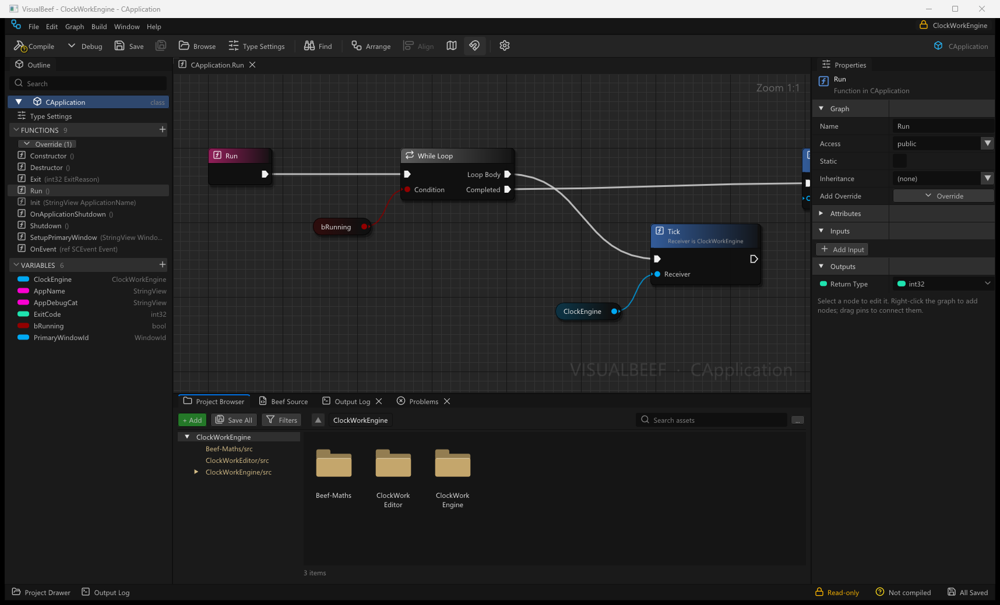

# VisualBeef

A visual node-graph editor for the [Beef](https://www.beeflang.org/) programming language.
Every graph **is** Beef code: open a `.bf` file and each function becomes a node graph. Edit the
graph and only the statements you touched are rewritten; edit the text and the graph is rebuilt.
There is no separate graph format, so your source stays the only truth, stays diffable, and builds
with the normal Beef toolchain.



*The editor on a function of the ClockWork engine (Release build): Outline, the node canvas, Properties
and the Project Browser.*

## What VisualBeef does

VisualBeef is a desktop application (Windows x64 today, Linux builds in progress) for people who write
programs in [Beef](https://www.beeflang.org/). It shows each function of a Beef source file as a graph of
nodes and wires, and lets you edit the program either way:

* **A node-graph editor that writes plain Beef source.** There is no separate graph format. Editing a graph
  rewrites only the statements you touched in the `.bf` file; editing the text rebuilds the graph. The file stays
  readable, diffable and under your version control.
* **Compiles with the Beef toolchain.** F7 runs the `BeefBuild` of your Beef installation on the project and
  shows the compiler's messages next to the nodes they belong to. Generated code is checked by compiling and
  running it in the test suites.
* **A debugger on the graph.** Run a program, stop on a node, read the values on its pins and step node by node,
  using Beef's own debugger engine from the installation.
* **Works with Universal Unreal Mod Platform (UMP) mod projects.** They open as ordinary Beef projects; see
  [docs/UMP-Integration.md](docs/UMP-Integration.md) and the
  [UMP repository](https://github.com/AproposRobin/UniversalUnrealModPlatform).

VisualBeef is not an installer-based product: unzip the package and run `VisualBeefEditor.exe`. It does not
collect data or change system settings; its only network use is the update check, which can be turned off
([docs/Updating.md](docs/Updating.md)).

## What it does

* **Graphs from code and back, losslessly.** Comments, spacing and style outside the edited statements are
  untouched; a one-node edit is a one-line diff. Tested round trip over corlib and real projects
  (about 3,500 methods in the standard runs).
* **Refuses to write unsafe graphs** instead of guessing: a value that would be evaluated twice, code that
  would run twice, a read outside its scope. The reason is shown on the node.
* **Node-graph editor**: Outline, Properties, Project Browser, Output Log, Compiler Results, Find in
  Sheets, minimap, alignment tools, a context-sensitive node menu, typed wires.
* **Switch and flow nodes as plain Beef**: Switch, Sequence, Do Once, Do N, Flip Flop, Gate, Multi Gate,
  loops with Break.
* **Nodes from your own code**: tag functions with `[Node]`, `[Pure]`, `[Expose]`... (library
  `VisualBeefMeta`) to decide what the menu offers; libraries you reference become nodes automatically.
* **Safe with your files**: nothing is written by just looking; atomic saves with a backup; conflict
  detection; Recycle Bin deletes; a read-only (`--view`) mode.

## Install

Unzip `VisualBeef-<version>-win64.zip` anywhere and run `VisualBeefEditor.exe`
(`vbhost.dll`, the fonts, the licences and these docs are in the same folder; nothing is installed and
nothing is written next to the exe). VisualBeef has its own name, version (`VERSION.txt`, `--version`),
licence and notices. [docs/Getting-Started.md](docs/Getting-Started.md#install) explains
the package, and `scripts\package.ps1` builds the package. VisualBeef offers new versions from this repository's
GitHub Releases and installs one when you choose, after checking its signature and SHA-256
([docs/Updating.md](docs/Updating.md)).

## Build and run

Requires Windows x64 and the Beef toolchain 0.43.6 in `C:\Program Files\BeefLang`.

```
"C:\Program Files\BeefLang\bin\BeefBuild.exe" -workspace=<repo> -config=Release -platform=Win64
build\Release_Win64\VisualBeefEditor\VisualBeefEditor.exe D:\path\to\your\beef\projects
```

Or open `BeefSpace.toml` in the Beef IDE and press F5 (`VisualBeefEditor` is the startup project). The
prebuilt `vbhost.dll` and the icon font are copied next to the program by the build. Add `--view` to open
a project read-only. Press **F7** to compile with BeefBuild. Step-by-step: [docs/Getting-Started.md](docs/Getting-Started.md).

Tests: `build\Debug_Win64\VisualBeefTests\VisualBeefTests.exe edits` (and the other suites, see
[docs/Testing.md](docs/Testing.md)).

## Documentation

Start at **[docs/README.md](docs/README.md)** for the reading order. Direct links:
[Getting Started](docs/Getting-Started.md) |
[Vocabulary](docs/Vocabulary.md) |
[Editor UI](docs/Editor-UI.md) |
[Architecture](docs/Architecture.md) |
[Parsing and Layout](docs/Parsing-and-Layout.md) |
[Codegen](docs/Codegen.md) |
[Flow Nodes](docs/Flow-Nodes.md) |
[Catalog and Types](docs/Catalog-and-Types.md) |
[Node Attributes](docs/Node-Attributes.md) |
[Files and Safety](docs/Files-and-Safety.md) |
[Testing](docs/Testing.md) |
[Continuous integration](docs/CI.md) |
[Release integrity](docs/Code-Signing.md) |
[Updating](docs/Updating.md) |
[Releasing](docs/Releasing.md) |
[Changelog](docs/CHANGELOG.md)

## Repository

```
BeefSpace.toml        open this in the Beef IDE
VisualBeefCore/       language layer: lexer, parser, graph, codegen, documents, catalog. No UI.
VisualBeefEditor/     the editor app (Dear ImGui; the node canvas is drawn in Beef)
VisualBeefMeta/       attributes ([Node], [Pure], ...) your projects can reference
VisualBeefTests/      command-line suites: round trip, edits, codegen compile-and-run, catalog, safety
Native/               SDL2 + OpenGL3 + Dear ImGui host (vbhost.dll) and its Beef bindings
docs/                 the manual
LICENSE, NOTICE        Apache-2.0 licence and attribution notice
THIRD_PARTY.md        licences of bundled components
```

## Status (end of Phase 1, 2026-10-10)

Working: everything above; Debug and Release build with 0 warnings; all test suites pass.

Known limitations (true today):

**Language coverage**

* Shown as Code nodes or as text in pins, and round-tripped exactly: `scope` / `new` / `delete` / `defer` / `using`
  forms that have no node yet, lambdas, local functions, tuples, `case .Ok(let v)` pattern tests, property accessors,
  expression-bodied members (`=>`), `const` locals, `fallthrough` / `when` / ranges / payload patterns in a `switch`,
  and string interpolation (edited as text).
* `out let x` stays text in the argument pin; `x` has no pin of its own.
* Calls on the current object have no Receiver pin; a catalog instance call with an empty Receiver is written as a call
  on the current object without checking the enclosing type.
* Static calls show the type name as text in a Receiver pin.
* `#if` regions: both arms are read as live code; the indexer de-duplicates members.
* Operators, delegates and `typealias` declarations appear as Raw members.
* A stray extra `}` that closes a type early, and a type missing its closing `}` whose sibling starts at the same
  indentation, are not detected as broken.

**Types**

* There is no compiler in the editor: unresolved types keep grey wildcard pins, and overloads are chosen by arity, then
  argument types. Wire checks are the editor's own rules; the compiler is the judge after **Compile**.

**Classes**

* No parent class, interface list, modifiers or attributes when creating or editing a type; no Override dropdown;
  function modifiers are read-only in Properties.

**Editing**

* Renames change the declaration only, not references.
* Undo is per document: node moves, resizes, knots and comments are undoable (one step per drag), but asset rename and
  delete across files are not. Each step is a whole-document snapshot.
* Reopening shows the code's natural shape (a typed-in value may come back as a Get node and the reverse).
* A comment inside an expression is lost when that expression is really changed.
* Flow macros are recognised only by their exact shape; their state is per object.
* A statement edited and shifted at the same time loses its saved position.
* Moving an asset does not rewrite its namespace.

**Shell, scale and platform**

* Library and project indexing run on the UI thread: a large game SDK takes several seconds the first time.
* Compile runs BeefBuild with the default (Debug) configuration; UMP mods need Release.
* No crash handler, minidump, autosave journal or log file.
* `VisualBeef_settings.txt` and `VisualBeef_layout.ini` are written to the current directory.
* Linux is experimental: tests and the editor session pass under WSL2, but there is no debugger, crash report,
  Recycle Bin or package there yet ([docs/Linux.md](docs/Linux.md)).
* Per-monitor DPI changes were not tested on a second monitor; the operating system draws the title bar.
* No installer.

Where it is going: a node-graph editor with nodes declared from Beef attributes, a viewer mode for
projects that are not VisualBeef projects, a compiler-backed language service, a debugger on the graph, and
a generated game SDK as a node library. See the roadmap.

## About the download warning

VisualBeef is open source and has no budget for a code-signing certificate, so Windows SmartScreen shows "unknown
publisher" ("Windows protected your PC") the first time you run a new version. Trust here comes from provenance instead:
every release is built by the public [workflow](.github/workflows/windows.yml) from a tagged commit and carries a build
attestation that ties each file to that workflow run.

To verify a download:

1. Attestation (needs the [GitHub CLI](https://cli.github.com/)):
   `gh attestation verify VisualBeef-<version>-win64.zip --owner AproposRobin`
2. Hash: the `.sha256` file beside each download holds the expected SHA-256. Compare it with
   `certutil -hashfile VisualBeef-<version>-win64.zip SHA256` (case does not matter). If either check fails, delete the
   file and do not run it.
3. Unzip, start `VisualBeefEditor.exe`, and on the SmartScreen prompt choose **More info**, check the file name, then
   **Run anyway**.

To build it yourself, see [Build and run](#build-and-run) above and [docs/CI.md](docs/CI.md), which describe the same
steps the workflow runs.

## License

VisualBeef is licensed under the Apache License, Version 2.0 (Copyright 2026 AproposRobin); see [LICENSE](LICENSE) and [NOTICE](NOTICE). Bundled third-party components keep their own licences ([THIRD_PARTY.md](THIRD_PARTY.md)); the prebuilt `vbhost.dll` statically links Dear ImGui, cimgui, imnodes, cimnodes (MIT), SDL2 (zlib), the LLVM C++ runtime (Apache-2.0 with LLVM Exceptions) and the mingw-w64 runtime, and their notices must travel with it.
