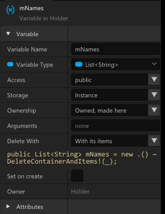
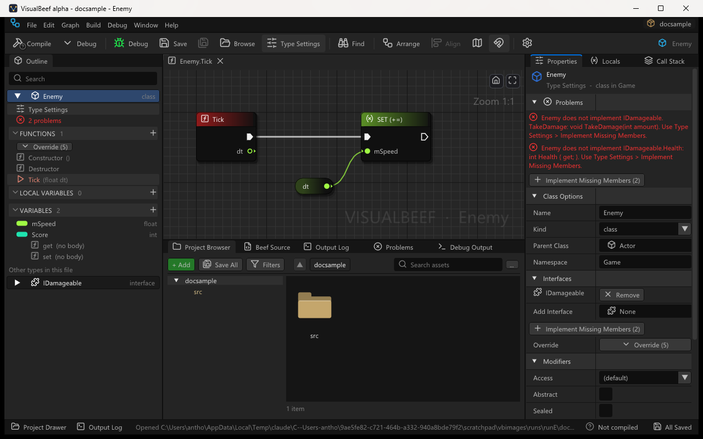
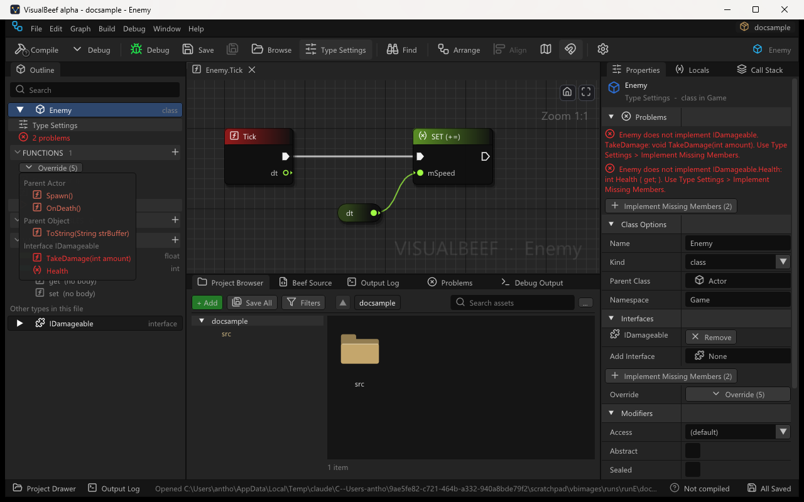
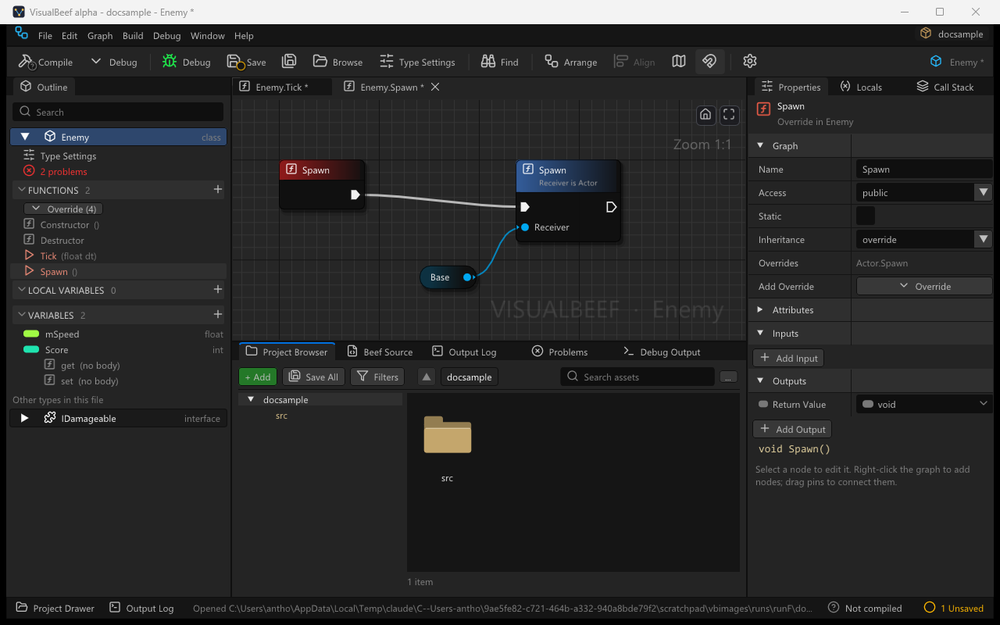
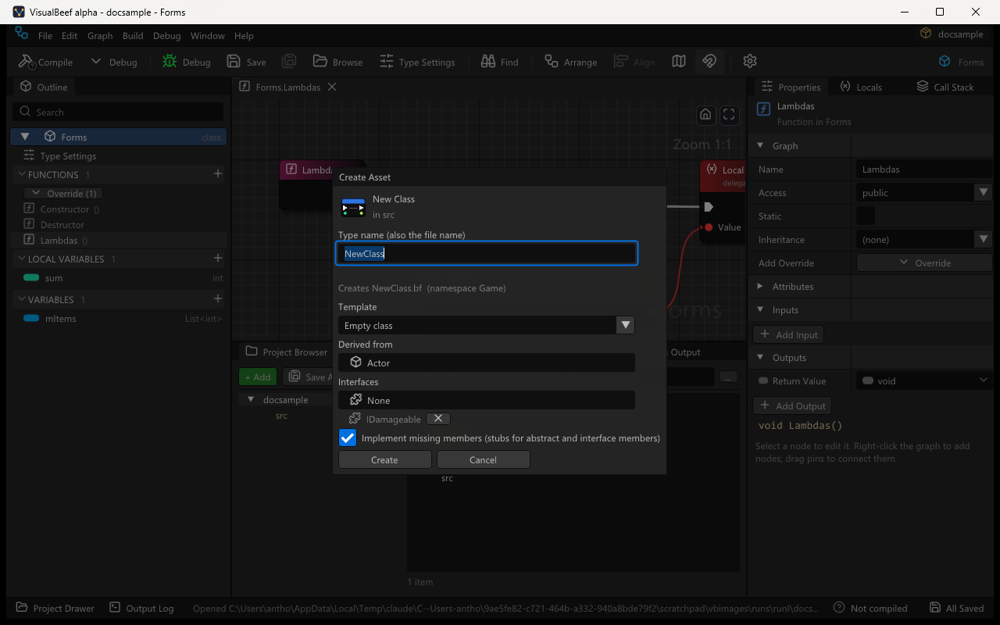

# Classes, structs, inheritance and interfaces

How VisualBeef edits the *type level* of Beef code: the declaration of a class, struct, enum or
interface (parent, interfaces, modifiers, attributes, generics), its members (functions,
properties, indexers, constructors, fields), overriding and implementing inherited members, the
**Base** (`base`) node, renames that update every reference in the project, and new types with a
parent from the start. This answers the production audit's owner gap 2
(with 6.3, 6.8, 6.9, and the UMP template of 8.2).

The owner's words: "classes/structs should have actual options and inheritance like normal and we
should be able to do things like use interfaces."

Where it lives:

| File | What |
|---|---|
| `Syntax/Ast.bf`, `Syntax/Parser.bf` | Declaration spans on `Member`; property / indexer accessors parsed as methods |
| `Document/TypeDecl.bf` | `Mods` (modifier words), `AttrList` (attribute lists), `TypeDeclInfo` (what Type Settings shows) |
| `Document/ClassEdits.bf` | The splice APIs on `SourceDocument` (one undo step each) |
| `Catalog/ClassModel.bf` | `ClassModel` (base / interfaces, Override list, missing members, stubs, pickers, the Entry check), `TypeTemplates` (new types, the UMP mod) |
| `Document/Rename.bf` | `RenameService`: the project-wide reference finder |
| `Graph/*` | `NodeKind.Base` ("Parent"), `Graph.DeclModifiers`, the override check in `GraphValidator` |
| Editor `TypeSettings.bf` | Type Settings, function / variable options, Override dropdown, attribute lists, pickers, rename preview, multi-file undo groups, Add Property / Indexer, the Create dialog options |

## Class-level edits

All are `SourceDocument` methods (`ClassEdits.bf`). Each is **one undo step**, a token-range splice
of the declaration, and keeps everything around it: comments, indentation, other members, and the
built graphs of every function whose body did not change (a header edit never rebuilds a graph).
They return `false` and set `LastError` when the edit cannot be made.

| API | Writes | Refused when |
|---|---|---|
| `SetModifiers(m, "public abstract")`, `SetModifierWord(m, "sealed", on)`, `SetVisibility(m, "protected")`, `SetInheritance(m, "override")` | the modifier words; a new word goes in the usual order (`public static override ...`), a replaced one stays where it was | `abstract` on a function with a body; `static` on an accessor |
| `SetAttributes(m, list)` | `[A, B(1)]` replacing the attributes; a new line above the declaration when there were none; removing deletes the line | |
| `SetTypeKind(type, "struct")` | the kind keyword | turning a type into an enum or back |
| `SetBaseList(type, list)` | `: A, B` (removing the last base removes the `:`); for an enum, the underlying type | |
| `SetGenericParams(type, "T, U")`, `SetConstraints(type, "where T : class")` | `<...>`, `where ...` | a list closed by `>>` |
| `SetNamespace(type, "A.B")` | renames the namespace declaration around the type | the namespace holds other types too (move the type to its own file first) |
| `SetFieldInitializer(field, "5")` | `= 5` (empty removes it) | `int a, b;` declarations |
| `AddOverride(type, member, callBase, out key)` | the override / implementation (below) | |
| `AddStubs(type, members)` | one stub per member, one undo step | |
| `AddFunction(type, mods, ret, name, params, out key)` | `mods ret name(params)` with an empty body (`return default;` when not void; `;` for abstract / extern / interface) | |
| `AddConstructor(type, access, params, chain, out key)`, `AddConstructor(type, isStatic, out key)`, `AddDestructor(type, out key)` | `public this(int a, String b) : base(a)` (any number, one per signature) / `static this()` / `public ~this()` | the same parameter types as another constructor; a chain that is not `base(...)` / `this(...)` or whose argument is neither a parameter of the new constructor (optionally behind `ref` / `out` / `in`) nor a literal (the message names the argument); a second static constructor; a second destructor (each message names the existing one) |
| `EnsureDefaultConstructor(type, out key)`, `EnsureDefaultDestructor(type, out key)` | the empty `public this()` / `public ~this()` after the fields and before the other functions, when the file has none (what opening a dimmed Outline row does) | |
| `AddProperty(type, T, name, setter, auto, out key)`, `AddIndexer(type, T, params, setter, out key)` | a property with `get` / `set` bodies (graphs) or `{ get; set; }`; `public T this[...]` | a second indexer |
| `ApplyRenameEdits(plannedText, edits, newName)` | a rename plan's edits for this file | the file changed after the plan; a function of the file whose graph holds a refused commit (edits not in the text) and whose text the rename would rewrite (the message names the function) |

Examples (from `VisualBeefTests classes`):

```beef
[Reflect]
public class Enemy : Actor, IDamageable        // SetBaseList + "IDisposable":
public class Enemy : Actor, IDamageable, IDisposable

public int mHp = 10;                           // SetModifierWord(mHp, "static", true):
public static int mHp = 10;

struct Point                                   // SetAttributes(Point, ["CRepr"]):
[CRepr]
struct Point
```

## Inheritance and interfaces

`ClassModel.Analyze(unit, type, typeService, info)` reads a declaration against the TypeService:

* **Base class and interfaces.** The first entry of the base list that resolves to a class (a struct
  for a struct) is the base class; interfaces are interfaces. Problems with the parent are document
  errors: a sealed or static parent, a class deriving from a struct (or the reverse), a second class
  in the list, an interface listing a class.
* **Override list** (`info.Overridable`): every `virtual`, `abstract` and `override` member of the
  base chain (most derived first, generic arguments substituted: `Holder<int>.Get()` returns `int`)
  and every member of the listed interfaces (and the interfaces they extend), minus what the type
  declares itself; private members are never offered. A class with no base list ends in `Object`
  (`ToString`; Object's runtime hooks such as `DynamicCastToTypeId` are left out).
* **Missing members** (`info.Missing`): abstract members of the base chain that nothing implements
  (only for a class that is not abstract) and interface members without a default body that neither
  the type nor its parents implement. Each one is a document error with a clear text:

  > Enemy does not implement IDamageable.TakeDamage: void TakeDamage(int amount). Use Class
  > Settings > Implement Missing Members.

  > Bare does not implement the abstract Actor.Tick: void Tick(float dt). Override it, or make Bare
  > abstract.

* **Overrides without a base** (`info.OverridesWithoutBase`): an own member marked `override` with
  nothing virtual or abstract of that signature in the chain.
* **Unknown is never an error.** When a base (here or further up) is in no index, `info.Unresolved`
  lists it and nothing is reported as missing; the compiler stays the judge.

Signatures compare the name, the parameter types (normalised) and `ref` / `out`.

### Stubs and overrides

`ClassModel.StubText(member, callBase, ...)` writes the declaration, in the file's brace style:

| Member | Written |
|---|---|
| virtual, with **callBase** (the Override dropdown: adds a call to the base function) | `public override void Tick(float DeltaSeconds) { base.Tick(DeltaSeconds); }`, `return base.Initialize();` for a non-void one, out / ref arguments passed on (`return base.TryGet(key, out value);`) |
| abstract, or callBase off | `public override ...` with `return default;` for non-void and `x = default;` for every out parameter |
| interface member | `public ...` (no `override`), same body rules |
| property / indexer | `get { return base.Score; }` / `set { base.Score = value; }` (or `default` / empty), a setter only when the base has one |

The visibility is the base member's (`protected override bool TryGet(...)`); interface members are
`public`. Every stub has a body, so it opens as a graph; `AddOverride` returns its key (a property's
getter) so the editor opens it.

### The Base node (`base`)

`base.Foo(x)` reads as a call whose **Receiver is wired from a Base node** (`NodeKind.Base`, a pill
like This, titled "Base", typed with the base class, writes `base`). The call is a member call
owned by the type that declares `Foo`. Before, `base` stayed as text in the Receiver pin. The node
menu offers **Get a reference to base** wherever there is a `this` and a base class. A Base node
in a static function is an error on the node ("There is no parent (base) here: this function is
static, so there is no this."). Layout keys hash a Parent-wired Receiver as the text `base`, as before.

### The override check (GraphValidator)

`ClassModel.CheckEntry(graph)` runs with the other GraphValidator checks: a function declared
`override` whose class has nothing virtual or abstract with that name and parameter types gets an
**error on its Entry node** and the commit is refused, like every graph error:

> 'Missing' is marked override, but no base class of Lone has a virtual or abstract Missing() to
> override. Pick it from the Override dropdown, or remove `override` in Properties.

Not reported: an unknown base anywhere in the chain, a class name declared twice (which one is
meant is not known), accessors, and, without corlib, Object's own virtuals. `Graph.DeclModifiers`
carries the modifiers (set by the builder and refreshed before every generation).

## Renames that update references (6.3)

`RenameService.Plan(...)` finds the references of a type, a member,
a parameter or a local over every **project** file (open files with their live text; libraries are
never touched), without the compiler:

* **Type**: every identifier with the name, in declarations, base lists, generic arguments, `new`,
  casts, parameters, locals, static calls (`Player.Create()`), namespace-qualified names. Where a
  member or local of the same name exists, only clear type positions are taken.
* **Member** (field, property, function): the declaration; bare uses inside the type and its
  subclasses (unless a parameter shadows it); `this.` / `base.`; `x.Name` where `x` is a parameter,
  a local (with its declared type, or `let x = new T(...)`), a field, a type name, or a chain of
  those, of the type or a subclass; `override` declarations in subclasses follow. The same name on
  an unrelated type is left alone.
* **Parameter / local**: every use inside that function, including the holes of interpolated
  strings (`$"total {total}"`).

Anything it cannot decide is a **problem**, and a plan with problems is refused as a whole: a local
of unknown type (`var x = Make(); x.mHealth`) when other types have a member with that name, a
member read on a call or an index result, an object initializer, a name inside an interpolated
string (members and types), a subclass member that hides the renamed one. The plan is also refused
when the new name is taken (a member of the type, a type of the project, a name used in the
function), for a method with overloads, an override (rename it in the base) or an interface
member (rename it in the interface).

`ApplyRenameEdits` writes each file's edits as one undo step; function keys that change (a renamed
type, a parameter type) keep their layout and pending orphans. In the editor the files are opened
if needed and left unsaved; the steps form one **multi-file undo group** (undo in any of the files
undoes the rename in all of them).

## Constructors and the default rows

A class or struct can have **several constructors**. FUNCTIONS **+ > Constructor...** (and Type Settings
> Add > Constructor) opens the Add Function dialog in constructor mode: *Access*, *Parameters* (the same
text and the same TypeSlotRules checks as a function: `params`, `ref`, `out` allowed) and, when there is
something to chain to, **Chain to another constructor first**: the parent's constructors
(`ClassInfo.BaseCtors`, listed by signature, private ones left out) and this class's own other
constructors. Create writes

```beef
public this(int a, String b) : base(a)
{
}
```

after the fields and the other constructors, before the other functions (the file's brace style), as
one undo step, and opens its Sheet. A chain passes the chosen constructor's own parameter names as
arguments; edit them in the text. The same parameter types as another constructor (modifiers count, names
and defaults do not) are refused with the existing one named ("Foo already has a constructor with these
parameters: Constructor (int, String)"); the dialog says so before Create, and `SetSignature` refuses to
turn one constructor into another's signature. The Outline lists each as `Constructor (int, String)`;
renaming is disabled (the name is `this`). A **static constructor** and a **destructor** stay single:
a second one is refused with a message that names the existing one (`static this()`, `~this()`). The static
constructor is only on the **+** menu.

**Default rows.** Every class and struct (not an interface, enum, extension or static class) shows
`Constructor ()` and `Destructor` in FUNCTIONS even when the file has none: drawn dimmed, tooltip "Not
written yet; open it to add it". Double-clicking one writes the empty `public this() { }` /
`public ~this() { }` (`EnsureDefaultConstructor` / `EnsureDefaultDestructor`, one undo step: after the
fields and, for the destructor, after the constructors, before the other functions) and opens its Sheet.
Deleting a written default (right-click > Delete Function) removes it from the file and the row is dimmed
again. The row stays while the only constructors written have parameters (`Constructor ()` is the
parameterless one). A new class from the Project Browser is empty: no written members at all (it used to
get `this()` and `Update()`).

## Set on create

A **variable can be marked "Set on create"**: creating the object then asks for its value. Beef has no
object initializers, so the marked variables become the parameters of one **create constructor** that the
editor owns. Tick **Set on create** in the variable's Properties (a row after *Default Value*) or in the
Add Variable dialog. For `mSpeed` (`float`) and `mName` (`String`) the editor writes, after the fields and
before the other functions (the file's brace style):

```beef
// VisualBeef: set on create
public this(float speed, String name)
{
	mSpeed = speed;
	mName = name;
}
```

* **Parameters** are in variable (declaration) order; the name comes from the variable: `mSpeed` -> `speed`,
  `Speed` -> `speed`, `_speed` -> `speed`. When the parameter name equals the variable's name the line is
  `this.speed = speed;`. Two variables that would get the same name, or a name that is a reserved word
  (`mBase` -> `base`), are refused with a message that names them; nothing is written.
* **Marking or unmarking regenerates only that constructor**, one undo step (the Add Variable dialog's
  checkbox is part of the same step as adding the variable). With no constructor yet it is created, so the
  Outline shows `Constructor (float, String)`; unmarking the last variable removes the constructor and its
  marker line. The other constructors, the dimmed `Constructor ()` row included, are never touched.
  `SourceDocument.SetFieldSetOnCreate(type, field, on)` / `AddFieldSetOnCreate`; `IsSetOnCreate`,
  `GetCreateState`, `GetCreateParamsText`, `FindCreateConstructor`.
* **Refused**: a constructor written by hand with the same parameter types ("Ship already has a constructor
  with these parameters: Constructor (float, String). Edit that one, or change the variables."), a static,
  const or several-per-line variable, and any change while the marked constructor is custom.
* **Read-back**: the editor finds the create constructor by its marker line (`// VisualBeef: set on create`
  among the comments right above it) and reads the checkboxes from it. It matches when the constructor is
  `public`, has no `: base(...)` / `: this(...)` chain, no default values, `ref` / `out` / `params`, and its body
  is only `variable = parameter;` (or `this.variable = parameter;`) lines, one per parameter, in the same order,
  each variable an eligible instance variable of the type with the parameter's type. Parameter names, spacing,
  line breaks and brace style may differ (they are rewritten on the next change). Anything else is
  **custom**: the checkboxes are off and disabled, labelled "custom constructor", with the tooltip that says why;
  edit it in the text, or delete the marker line so the editor writes a new one. A constructor without the
  marker is an ordinary constructor.
* **Construct node**: *Construct <Type>* (the Node menu's `new T(...)`) for a class of the file, or of
  another file of the project, spawns one input per parameter of its create constructor (or, with no marked
  constructor, of its only constructor that has parameters; with several and none without parameters, of the
  first), named and typed like the parameters. A "set on create" input starts with the variable's own
  initial value (`= 1` in the file) or `default`, so the node is writable at once; edit it or wire a value in.
  Structs work the same way.
* Limits: the child class's create constructor does not chain to the parent's: a parent without a parameterless
  constructor needs `: base(...)`, which makes the constructor custom.

## New types and the UMP mod

`TypeTemplates.Make(kind, ns, name, modifiers, baseList, members, out)` writes a new type file
(`class Turret : Actor, IDamageable`); a new class has no members at all (its constructor and destructor
are the dimmed Outline rows, written when opened), a struct gets one `int Value;`. The Create dialog adds stubs for what the parent and the interfaces require
(abstract and interface members) when **Implement missing members** is on.

`TypeTemplates.MakeUMPMod(ns, className, modId, modName, version, out)` is the UMP mod entry point
(production audit 8.2; UnrealUMP binds its "visual mod" kind to it): the `[AlwaysInclude]` entry
class that registers the mod, and `class ModMain : UMPMod` with `Info()`, and `Initialize`, `Tick`,
`Shutdown` overrides as block bodies, so each one is a graph and `Tick` is the visual **Tick override**.
The file also has `using UnrealUMP.Unreal;` (the game SDK's namespace) and writes the id, name and
version as escaped string literals. It is the source of truth for a visual mod's `src\ModMain.bf`:
UMP's launcher writes the same bytes, and `--new-ump-mod` writes it from the command line

The Override dropdown then offers `OnEngineReady` and `OnWorldReady`.

## Ownership and initial values

The owner's words (2026-10-11): "for a class property I can put `new .() ~ delete _`, but that is not
going to work for people who don't understand Beef. Default values should have a type identification
and a setter." A member variable's initializer and destructor clause are now two choices,
**Ownership** and **Initial Value**, and VisualBeef writes the Beef idiom for them.

Where it lives: `Document/MemberInit.bf` (`MemberInit`: read, write, the choices of a type, literal
formatting), `Document/ClassEdits.bf` (`InitRange`, `ReadMemberInit`, `SetMemberInit`),
`SourceDocument.AddField(type, T, name, MemberInit)`, the editor's `InitEditor.bf` (the rows), and
`VisualBeefTests` `InitTests.bf` (a `classes` group and the `inits` command).

### The choices

| Ownership | For | Beef written | Meaning |
|---|---|---|---|
| **Owned, made here** | classes, `String`, arrays, unknown types | `Application mApp = new .() ~ delete _;` (`new .(args)`, `new int[4]`) | made with the object, deleted with it |
| **Owned, set later** | classes | `Application mApp ~ delete _;` (also read: `= null ~ delete _`) | starts null; whatever it holds when the object goes is deleted |
| **Reference** | classes, interfaces | `Application mApp;` (or `= null`, `= "text"` for a String, any expression) | holds an instance something else owns; never deleted here |
| **Pointer** | every type | `Application* mApp;` (or `= null`) | an address; the `*` is added to the type, and removed when another choice is picked |
| **Appended** | instance members of a class | `Application mApp = append .();` | stored inside the object's memory, made and destroyed with it |
| **Owned for the run** | static member variables of a class, `String`, unknown types | `static Application sApp = new .();` (`new .(args)`, no delete) | made once, lives for the whole run of the program, never deleted |
| **Disposed with it** | structs, classes, unknown types | `Event<int> mEvt ~ _.Dispose();`, `Point mP = .(1, 2) ~ _.Dispose();` | when the object goes, the value's own `Dispose()` runs; with an Initial Value of `.()` / `.(args)` / `default` / an expression before it |
| **Value** (struct) | structs, nullable, tuples, fixed arrays | nothing, `= .()`, `= .(1, 2)`, `= Point(1, 2)`, `= default` | a value stored in place |
| **Value** | numbers, bool, characters, enums, `StringView` | nothing or `= value` | no Ownership row, only the Initial Value |
| **Custom** | anything else | kept exactly as written | `~ { ... }`, an instance member's `= new .()` without a delete (deleted somewhere else, or a leak), ... |

An owned container also gets **Delete With**: `delete _` ("Delete it"), `DeleteContainerAndItems!(_)`
("With its items"), `DeleteDictionaryAndKeys!(_)`, `DeleteDictionaryAndValues!(_)`,
`DeleteDictionaryAndKeysAndValues!(_)`. `delete(_)` and `DeleteContainerAndItems! (_)` read as the same
choice and are written back as they were.

| Initial Value | Control | Beef written |
|---|---|---|
| None | | nothing (the zero value: `0`, `false`, null, a zeroed struct) |
| Number | number box | `5`, `-3`, `0xFF` kept as written; a typed value becomes `2.0f` for `float`, `2.0` for `double`; a negative value is refused for an unsigned type |
| True / false | checkbox | `true` / `false` |
| Character / Text | text box | `'a'`, `"say \"hi\""` (escapes written for `\`, quotes, line breaks, tabs, control characters) |
| Member | dropdown of the enum's members (from the index) | `.Red` (also read: `Color.Red`) |
| `default` | | `= default` |
| `null` | references and pointers | `= null` |
| Made here `.()` | structs, with an Arguments box | `= .()`, `= .(1, 2)` |
| Expression | text box | any expression, as typed |

Only the choices legal for the type are offered: an interface gets Reference and Pointer; a struct
Value, Disposed with it and Pointer; a member of a struct or a static member never Appended; Owned for
the run only for a static member (an instance member made with `new` and never deleted stays Custom, and
`SetMemberInit` refuses the choice for one); a property (only a `{ get; set; }` property has an initial
value) and a `const` never an Owned, Appended or Disposed choice (`SetMemberInit` refuses them with a reason
too). A type the index does not know keeps every choice, and the Ownership row says **(type not indexed)**
under it (Properties and Add Variable), so it is clear why nothing was narrowed down.

Construct nodes for a class with "set on create" variables start each parameter pin with the variable's
**Initial Value** as read here (`= 2.5f` gives `2.5f`, `= new .(3) ~ delete _` gives `new .(3)`, no value gives
`default`), not the text of the destructor clause.

### Reading and writing

`MemberInit.Classify(tail, type)` reads the text after the member's name up to its `;`. It always
succeeds: when the text is one of the choices it is written back **byte for byte** (the spacing before
`=`, after `=`, before `~` and before `;` is kept, so aligned declarations stay aligned); anything else
is **Custom** with the raw text. A Custom text that is one of the choices apart from its spacing
(`= new .()~delete _`) can be converted (**Convert To**), which writes the usual spacing.

`SetMemberInit` splices only that range (and the type, for a Pointer): every other byte of the file is
kept, one undo step, nothing written when nothing changes. `T x ~ delete _;` used to be an unread
member; it is now a member variable (`Member.DtorTok` marks its `~`), so it shows in Outline, renames
and Properties. A pointer written C style (`T *name`) comes back as `T* name` after a round trip
through another choice.

On the corpora (`VisualBeefTests inits`, 2026-10-11) every member is read and written back byte for
byte, then flipped to another legal choice and back to the same bytes:

| Corpus | Members | Custom | Top Custom forms |
|---|---|---|---|
| corlib (`BeefLibs/corlib/src`) | 2,061 | 29 (2 convertible; 53 before Owned for the run / Disposed with it, 24 now read as Disposed with it) | `= new T[](...) ~ delete _` 9, `~ { ... }` 4, `~ X(..) delete _` 3 |
| UMP `src` | 997 | 3 | `= Stopwatch.StartNew() ~ delete _`, `~ ClearAndDeleteItems!(_)`, `~ { ... }` |
| UMP `UMPRuntime/src` | 376 | 9 (45 before: 36 static `= new .(...)` members now read as Owned for the run) | `= new .(...)` on instance members of `ModLoader` with no delete 9 |
| UMP `UnrealSDKCore/src` | 707 | 0 | |
| ClockWork | 133 | 0 | |

### In the editor



* **Properties > Variable**: **Ownership** (a tooltip on each choice), then per choice **Arguments**
  (**Initial Text** for an owned `String`), **Delete With** for containers, or **Initial Value** and
  **Value**; a Custom member shows **Written As** (editable) and **Convert To**. Under the rows, the
  declaration as the file has it, in the code font. A typed value that does not fit (`12x` for an
  `int`) is shown in red and not written. **Initial Value > Expression** starts with the value
  there is now and writes nothing until an expression is typed; it stays chosen while that value
  still reads as another mode (`0`, `default`: `InitExpressionChoice`). What is typed must be one
  Beef expression (`MemberInit.CheckExpression`): otherwise the box is framed red, the reason is
  shown under it and nothing is written.
* **Add Variable**: the same choices under the type, with defaults (class: Owned, made here;
  interface: Reference; struct: Value; value types: None) and the declaration it will write.
* **Local variables** (Outline > LOCAL VARIABLES, selected): **Ownership** for class types and
  **Initial Value** with the same controls (see [Local variables](#local-variables)), with the
  declaration under them. A Local Variable node read from the middle of a function has the same
  Initial Value rows.

## In the editor



* **Type Settings** (the *Type Settings* row at the top of a type in Outline, or the toolbar
  button): *Problems* (the document errors in red and **Implement Missing Members (N)**), *Class
  Options* (name, renaming every reference with a preview; kind; parent class / parent struct with a
  picker of the project's and the libraries' types, without sealed and static classes and without
  the type itself; an enum's underlying type; namespace), *Interfaces* (remove, **Add Interface**
  picker, Implement Missing Members, **Override**), *Modifiers* (access, static, abstract, sealed,
  partial), *Attributes* (one row per attribute, remove, **Add Attribute** with presets: AlwaysInclude,
  Reflect, CRepr, Packed, Ordered, Union, Inline, NoDiscard, Obsolete, Node, Pure, Expose, NodeHidden,
  ExposeType), *Generics* (parameters, constraints), *Values* (enums: the cases, and the Enum
  Editor), *Add* (constructor, static constructor, destructor). Every change is one undo step and
  rewrites only that part of the declaration.
* **Function properties** (*Graph*): access, static, **Inheritance** (none / virtual / override / abstract
  / new), mut (struct functions), *Overrides* (the parent function, or "nothing to override" in red),
  **Add Override**, attributes. Each *Inputs* row has a **Passing** chooser: value, `out`, `ref` or `in`
  (Beef takes the three on a parameter of any type, not with a default value and not on an untyped mixin
  parameter; `params` / `mut` rows keep their word). A call passes an `in` parameter as a plain variable
  (`F(x)`: Beef 0.43.6 has no `in` in an argument list, and a typed literal is refused there). The Add
  Function dialog has the same rows and a Return Type picker. Renaming a function, or one parameter in *Inputs*, renames its uses
  in the project (preview first). Accessors show no Inputs / Outputs; constructors and destructors
  are labelled as such. A constructor lists its parameters in *Inputs* like a function (changing them
  rewrites the `this(...)` line and keeps a `: base(...)` chain; a signature another constructor
  already has is refused); its name stays `this`.
* **Variable properties**: access, **Storage** (instance / static / const / readonly / static readonly;
  properties: instance / static and inheritance), **Ownership** and **Initial Value** (see
  [Ownership and initial values](#ownership-and-initial-values); a plain **Default Value** text for
  `int a, b;` lines), the get / set graphs, attributes. Renaming renames every use.
* **Outline**: the *Type Settings* row and a red *N problems* row; FUNCTIONS has an
  **Override (N)** dropdown (grouped by parent and interface, abstract members in red) and its **+**
  opens a menu: Function, Override, Constructor..., Static Constructor, Destructor, Property (get / set
  graphs), Indexer. Every class and struct also lists a **Constructor ()** and a **Destructor** row,
  dimmed with the tooltip "Not written yet; open it to add it" until the file has them (see below). Overrides are listed with a red event icon; properties and indexers list their
  `get` / `set` rows, each opening its graph.
* **Override dropdown**: choosing a member adds it with the right signature (`override`, the
  parent's visibility, its parameters) and the parent call, and opens its graph. The entry of an
  override is drawn with a red entry.




* **Rename preview** (*Rename References*): the summary ("7 references in 2 files"), every line that
  changes per file, and the problems; **Rename N** is disabled while there are problems. The Output
  Log (category `Rename`) gets the same lines, so a refusal is explained there too.
* **Local variables**: renaming one in the Outline or Properties renames its uses in the function
  (directly when nothing else says its name, else with the rename preview); a Local Variable node
  read from the middle of a function keeps **Rename with Uses...**.
* **Project Browser > Add > New Class / Struct / Interface / Enum**: a **Template** (Empty class, or
  **UMP Mod (ModMain : UMPMod, Initialize / Tick / Shutdown)**), **Derived from** (the same picker:
  project and library types), **Interfaces** (add / remove), **Implement missing members**; an enum
  gets an underlying type, an interface the interfaces it extends.



* **Protected members**: the node menu offers the protected functions of the parents under
  *Functions | Parent (inherited)* (called with this); private ones never.
* **Problems** are also written to the Output Log (category `Class`) once per change.

## Node Libraries and global variables

A **Node Library** is a type kind next to Class, Struct and Interface: global functions and global
variables under one name. In Beef it is a `static class`, written and read byte for byte. A `class`
that happens to hold only static members stays a Class; only the `static` word on the declaration
makes a Node Library (`Member.IsNodeLibrary`). A `static { }` block of globals is not one.

```beef
namespace Mod
{
	static class Tools
	{
		public static int sCount = 3;
		public static String sName = new .() ~ delete _;
		public static int Twice(int x)
		{
			return x * 2;
		}
	}
}
```

* **Creating one.** Project Browser > New > **New Node Library...**, or **New Class** and the Template
  chooser's "Node Library" entry (the title, icon and file follow); Type Settings > Kind > **Node Library**
  turns a class into one (`SetTypeKind(type, "library")`: refused, naming the first one, when the class has a
  parent, interfaces, or members that belong to an object: instance variables, functions, constructors,
  a destructor). Kind back to Class removes the word `static`; a library cannot jump straight to a struct.
  It is one undo step.
* **Shown like a class.** Its own Outline entry (amber library icon, kind "node library") with
  Variables and Functions sections, opened like a class. Type Settings has no parent, interfaces,
  Override list, Static / Abstract / Sealed rows, constructors or destructor; the Static Constructor
  stays.
* **Everything is static.** Add Function and Add Variable write `public static ...` whatever the dialog
  says; the Static checkbox of a function is on and locked, a variable's Storage offers Static, Const and
  Static Readonly only, and `SetModifierWord(member, "static", false)` is refused ("Tools is a Node Library:
  everything in it is static."). A member written without `static` by hand is treated as static.
* **Called from any Sheet** as `Tools.Twice(...)`: no Receiver pin (see
  [Calls-and-Receivers.md](Calls-and-Receivers.md)). The Node menu lists the functions under
  **Libraries > Tools**.
* **Never constructed.** Construct does not offer a library. Read from code, `new Tools()` is a warning on
  the node; made in the editor it is an error: "Tools is a Node Library: it cannot be constructed. Call its
  functions and read its variables directly." A **This** node inside a library function is refused:
  "There is no this in Tools: a Node Library holds only static functions and variables, so there is no
  object to refer to."

**Global variables** are static fields. On a Class, Add Variable has a **Static (a global variable)**
checkbox and Properties > Storage has Static; in a library the variable is always static. Every static
variable gets Get and Set nodes in the Node menu under **Globals > Owner** (from any Sheet), written
`Owner.Field`. The Ownership / Initial value rows apply, with the static choices (no `append`, no Set on
create); the read-only Beef line shows the written form, for an owned object
`public static String sName = new .() ~ delete _;`.

## Outputs

The owner's words (2026-10-12): "Allow multiple outputs in a function." Properties > **Outputs**
lists the **Return Value** (its type, `void` for none) and then one row per further output: a
name, a type picker, move up / down and remove, and **Add Output**. Each further output is an
`out` parameter in the Beef, and the header the rows stand for is shown read-only under them:

```beef
public bool TryGet(int64 key, out int value, out String name)
{
	value = 0;
	name = null;
	return false;
}
```

* The **Return** node has one input per output after the Return Value (`value`, `name`). A Return
  writes `name = value;` for each output that has a value, in order, then `return <value>;`. A
  Return placed from the Node menu starts each with its type's default (as the Return Value does),
  so the function compiles at once; adding an output in Properties gives every Return of the
  function the new input with its default in the same undo step.
* Read from code: the assignments to `out` parameters right before a `return`, in parameter order,
  are that Return's inputs (the node's text is the whole run, written back byte for byte). An
  assignment elsewhere (earlier, or out of order) stays a Set node. Returns inside a lambda or a
  local function have no output inputs.
* A call of the function has one output pin per output (the out pins of the call model,
  [Calls-and-Receivers.md](Calls-and-Receivers.md)), unchanged.
* The Inputs rows still offer **Passing > out**: such a row moves to Outputs (it is the same
  parameter). Constructors list their `out` parameters under Inputs (they have no Outputs).
* Where it lives: `GraphBuilder.TryBuildReturnWithOuts`, `NodeFactory.AddReturnOutPins` /
  `SyncReturnOutPins`, the `.Return` case of `CodeGen.StatementText`, `SourceDocument.SetSignature`
  (syncs the Returns), the editor's `LocalsPanel.bf` (`DrawOutputRows`).

## Local variables

The owner's words (2026-10-12): "Eliminate the Local Variable node; functions get an implicit
locals panel, like global vs local variables." A function's **local variables** are the
declarations at the top of its body, in order (`Graph.Locals`). They are not nodes on the Sheet:

* **Outline**: under the function whose Sheet is in front, **LOCAL VARIABLES** with a count and
  **+**, one row per local variable (type-coloured pill, name, the type dimmed). Click selects it
  (Properties shows it), double-click edits the name in place, drag onto the Sheet places a Get
  (Ctrl) or a Set (Alt) or asks, the context menu has Rename, Move Up / Down and Delete. **L** on
  the Sheet adds `int newLocal = 0;` and selects it with its name box focused.
* **Properties** (one selected): Variable Name, Variable Type, **Ownership** for class types
  (**Reference**: holds an object made elsewhere, `= null` or an expression; **Made for this
  call**: `String name = scope .();`, with Arguments, or Initial Text for a String), **Initial
  Value** with the member variable controls (None, Number, True / false, Text, Member, `default`,
  `null`, `.()`, Expression), the declaration line, Delete Local Variable.
* **Node menu**: *Variables | Local Variables* has Get and Set for each; there is no Local Variable node in
  the menu and no hotkey for one.
* **Beef**: the declarations are written first, in list order, then the flow from the entry:

```beef
public bool TryGet(int64 key, out int value, out String name)
{
	int count = 0;
	String label = scope .();
	count = 5;
	value = 0;
	name = null;
	return false;
}
```

* **Read from code**: the declarations at the top of a body with a type (not `let` / `var`), no
  `const` / `ref`, no attribute, and a value that needs no node of its own (a literal, a name,
  `.()`, `new` / `scope` of a type with typed arguments, an operator or member read; not a call)
  are the local variables, written back byte for byte. The run stops at the first statement that
  is not one. A declaration later in the body stays as it was (a Local Variable node in the flow,
  read only from code); its Properties offers **Move to Local Variables**, which declares it at the top
  instead. A move changes when the value is computed (before the statements that were above it),
  which can change what the program does, so it is only done when asked. The pin context menu's
  **Make local variable** adds a local variable from a pin (see [Editor-UI.md](Editor-UI.md#canvas)).
* Where it lives: `Graph.Locals`, `Graph.ExtractLocals` / `CanBeLocal` / `MoveToLocals` /
  `AdoptLocals` (after a commit), `NodeFactory.AddLocal`, `CodeGen.EmitBody`, `OrphanStore.Restore`
  (the local variables are declared before the unconnected code), the editor's `LocalsPanel.bf`
  and `Outline.bf`, tests in `VisualBeefTests/src/LocalsTests.bf` (`classes`, `flow`) and
  `VB_SELFTEST=fnlocals`.

## Limits

* A type renamed in Type Settings keeps its file name; the Project Browser's **F2** runs the same
  rename (preview, references) and then renames a file named after its only type
  (`Player.bf` -> `Hero.bf`). Renames are refused rather than guessed: a code base with many
  same-named members read through `var` locals refuses member renames until those lines are typed.
* `SetNamespace` renames the namespace declaration, so a file with several types is refused.
* Expression-bodied members (`=> expr`) have no graph; give them a body in the text first.
* Overloads are not offered separately in the rename (refused) and the override check compares
  parameter types as text (a differently spelled but equal type is not matched; it is then an
  error only when the whole chain is known).
* Keyboard input cannot be scripted in the UI captures, so the rename preview was checked by the
  tests, not captured.
