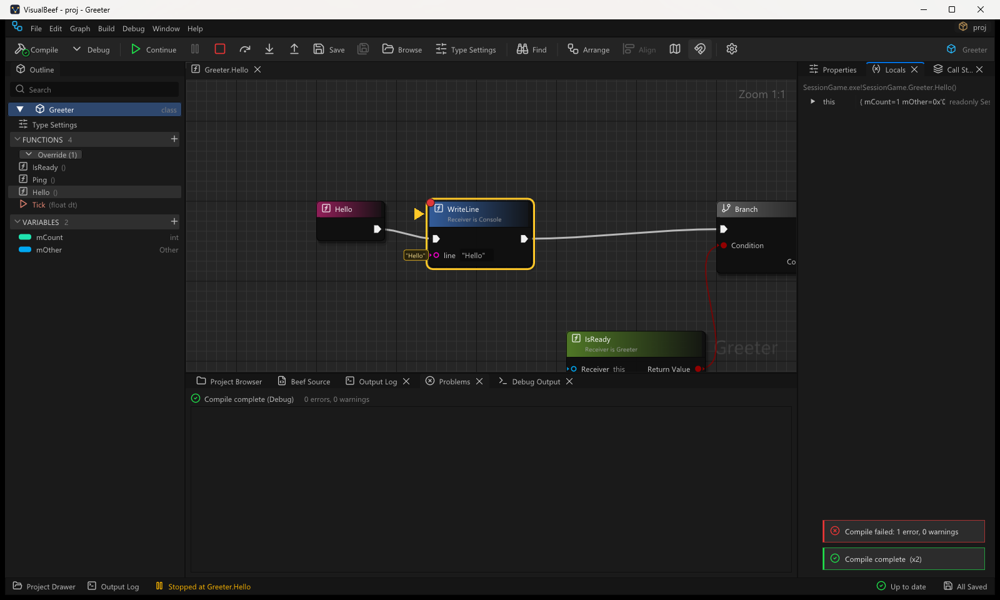
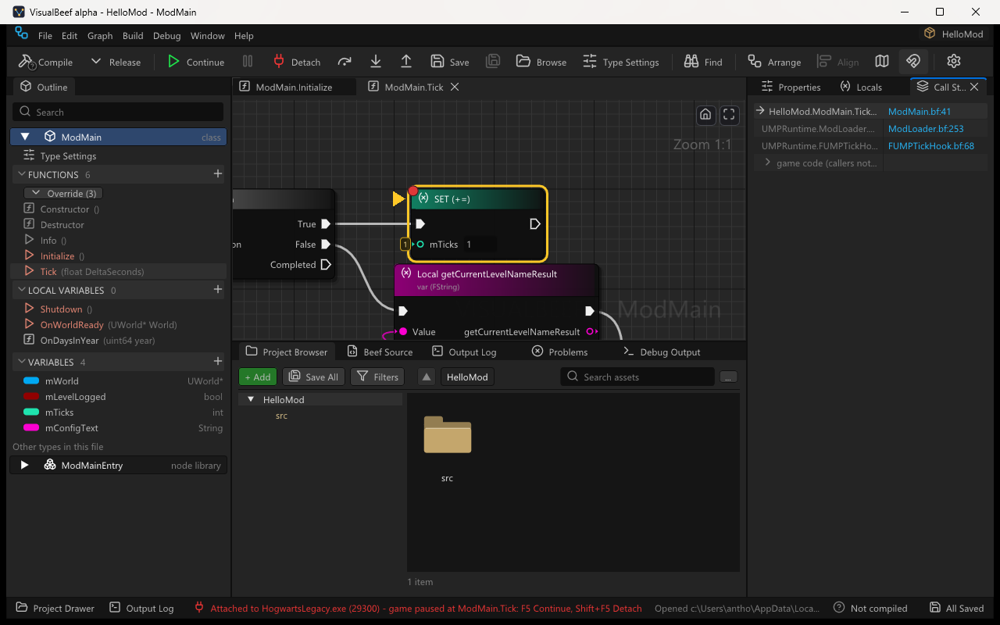

# Debugging

Run a program from VisualBeef, stop it on a node, look at the values on the pins, and step
through the Sheet node by node. Start Debugging runs standalone Beef programs (a workspace whose
startup project is a console or Windows program, built in Debug). **Attach to Game** debugs your
visual mod inside a running game started by the UMP launcher (see [Attach to game](#attach-to-game)).

## Quick start

1. Open a project folder that has a `BeefSpace.toml` (File > Open Project Folder...).
2. Open a Sheet and click the small circle on the top-left corner of a node (or select the node
   and press **F9**). A red dot means the node has a breakpoint.
3. Press **F5** (Debug > Start Debugging, or **Debug** on the toolbar). VisualBeef saves, compiles
   the workspace in **Debug** (whatever the configuration dropdown says) and runs the startup
   project.
4. The program stops before the node runs: the Sheet opens on it, the node gets a yellow outline
   and an arrow, and the values of its pins are written beside them.
5. Hover any pin of the Sheet to see its value. **F10** runs the node and stops at the next one,
   **F11** goes into the function the node calls, **Shift+F11** runs to the end of the function,
   **F5** continues to the next breakpoint, **Shift+F5** stops the program.

## Keys and commands

| Keys | Command | What it does |
|---|---|---|
| **F5** | Start Debugging / Continue | Not debugging: compile in Debug, then run. Stopped: continue. |
| **Shift+F5** | Stop Debugging | Ends the program. |
| (toolbar, Debug menu) | Pause | Stops a running program wherever it is (the main thread is shown). |
| **F9** | Toggle Breakpoint | On the selected node(s); also a click on the node's corner circle. |
| **F10** | Step Over | Runs the stopped node; stops at the next node of the Sheet. |
| **F11** | Step Into | Goes into the function the node calls, when it is your code. A call into a library (corlib, BeefLibs) is stepped over: stepping stays in the workspace's own files. |
| **Shift+F11** | Step Out | Runs to the end of the function; stops in the caller. |
| (Debug menu) | Attach to Game... | Lists the running games with the UMP runtime; attaches the debugger to the one you pick (see [Attach to game](#attach-to-game)). |
| **Shift+F5** while attached | Detach | The debugger lets go; the game keeps running. Also the toolbar's red **Detach** button. |
| (Debug menu) | Remove All Breakpoints | For the current workspace. |

In the Project Browser, F5 still refreshes the browser.

## What you see

* **Breakpoints**: a red dot on the node's top-left corner. Moving the mouse near a node's corner
  shows a faint ring there: click it to set a breakpoint. A node that cannot have one says why in
  the ring's tooltip (see [Which nodes can have a breakpoint](#which-nodes-can-have-a-breakpoint)).
  Breakpoints are saved per workspace in `settings.json` (`projects.<workspace>.breakpoints`), never
  in the source. Each is stored as the file, the function and the node's content-keyed layout key
  (the key the `.vblayout` side file uses), so it stays on its node when lines move above it.
* **The stopped node**: yellow outline and an arrow on its left. The Sheet opens on it (a new tab
  if needed) and scrolls it into view. The editor window comes to the front.
* **Values on the stopped node**: each data pin with a value gets a small label beside it.
* **Values on hover**: while stopped, the tooltip of any data pin adds `Value: ...` (or why there
  is none). This works for every function on the call stack, not only the stopped one.
* **Locals** panel (docked with Properties): the variables of the selected frame with value and
  type; objects and structs expand member by member.
* **Call Stack** panel: one row per frame, your files in normal text, library and system frames
  dimmed; double-click a row to open that function's Sheet at the node (or the text at that line
  when the line is outside every Sheet). The selected frame also drives Locals and the pin values.
* **Debug Output** panel (with the Output Log): what the program writes to its console, with
  Clear and Copy. The program gets no console window.
* **Status bar**: "Running", "Stopped at Greeter.Hello" (with "(fault)" after a crash), "Not
  debugging" after a session.
* **Output Log**, category `Debug`: the command line, the engine used, "Process terminated.
  ExitCode: N." and the engine's messages; a toast says "The program exited with code N".

## Attach to game

A UMP mod is a DLL inside a game that Steam or Epic started and the UMP launcher injected; VisualBeef
cannot start that game itself, so it attaches to it.

1. Open your mod's project folder in VisualBeef, compile it in **Release** and install it in the game
   (the launcher's Install, or `--pack-mod` then `--install-zip`). Start the game from the UMP launcher.
2. Set breakpoints on the nodes you want to stop on (a node in `Tick` stops every frame).
3. **Debug > Attach to Game...** lists the running processes that have the UMP runtime
   (`UMPRuntime.dll`) loaded, with the mods each has loaded. Pick the game and press **Attach**
   (or double-click it). **Refresh** lists again.
4. Under the list, a line says whether the picked game runs **this project's** mod:
   * green: `HelloMod.dll is loaded and matches this project's Release build`: breakpoints will stop
     the game;
   * yellow: the mod is not compiled, not loaded in that game, compiled from another copy of the
     project folder, or the game runs an older build than the one in `build\` (reinstall the mod and
     restart the game, or stops land on the wrong nodes);
   * red: the DLL in the game has no debug information, or its symbol file (`.pdb`, written next to
     the build output) is gone.
5. When the game reaches a breakpoint it **pauses** (every thread of the game stops): the Sheet opens
   on the node, Locals and Call Stack show the mod's frame, F10 / F11 / Shift+F11 step, **F5**
   continues. Remove the breakpoint or Continue to let the game run again.
6. **Detach** (Shift+F5, the toolbar's red Detach, or Debug > Detach) ends the session; the game
   keeps running. Closing VisualBeef while attached detaches too, and so does VisualBeef ending in
   any other way: attaching never kills the game.

While attached the status bar is **red**: `Attached to HogwartsLegacy.exe (14852) - running`, or
`- game paused at ModMain.Tick: F5 Continue, Shift+F5 Detach` while it is stopped. A paused game
stays paused until you continue or detach.

* **Call Stack**: your mod's frames (and the UMP runtime's, which has symbols) are normal rows; runs
  of frames without source (the game's own code) are one dimmed **game code** row. Tick **Show game
  code frames** to see each one. When the game's main program file has no symbol file on your PC, the
  debugger does not read it (see below) and the stack ends with a `game code (callers not shown: no
  symbols)` row.
* **Locals**: a Release build is optimised: fields (`this`, `mTicks`) read fine, but some parameters
  and locals live in registers and show stale or meaningless values.
* **Debug Output**: the attach and detach lines and the debugger's messages. What the game and its
  mods log goes to the UMP runtime log (the launcher's Logs page).
* Exceptions the game raises and handles itself are not stops; the Output Log says how many there
  were when you detach.

Things to know:

* Breakpoints are placed by source path and line, matched through the symbol file the build wrote
  (its path is inside the DLL), so the DLL the launcher copied into its mods folder still finds it.
  Compile and install from the same project folder you have open.
* The game's own main program file is read only as its headers when it has no symbol file here: Beef
  0.43.6's debugger engine crashes on some protected game executables (Hogwarts Legacy's), so
  VisualBeef never lets it read one.
* One debugging session at a time; Start Debugging is unavailable while attached.
* Windows only. Attaching needs the same rights as the game (a game run as administrator needs
  VisualBeef run as administrator), and no other debugger attached.

## Faults

An unhandled fault (an access violation, a failed check of the runtime) stops the program at the
node that faulted: the node is marked like any stop, the message ("The program stopped on a fault:
EXCEPTION_ACCESS_VIOLATION reading from 0x0 ...") is a toast and an error row in **Problems** (on
that node), and the status bar says "(fault)". When the fault happens inside a library, the Sheet
shown is the first frame of the call stack that is in your workspace. Continue passes the fault on
to the program (which usually ends it); Stop ends it.

## Which nodes can have a breakpoint

| Node | Line used |
|---|---|
| Statements (calls with flow pins, Set, Local with a value, Branch, loops, Switch, Return, Break, Continue, Code, Delete, Defer, Using, Result: match, ...) | the node's first line |
| The function's entry node | the line of the body's `{`: stops when the function starts (on its first statement) |
| Values (Get, operators, Cast, pure calls, Construct, Lambda, Format Text, ...) | the line of the statement that uses the value |
| No line (the circle is disabled and says why) | a node not in the code yet (unconnected, or not committed), a value nothing uses, a Local declared without a value, a local function's declaration, code that could not be read |

Several statements on one line share it: a stop on that line shows the innermost one.

## Limits

* No hot reload: edit, compile, reinstall the mod (attached) or F5 again (a program).
* Values are read, never computed: properties and calls are not evaluated; a pure call's pin
  shows "Shown only by running code".
* Editing the Sheet while stopped is allowed, but the running program is the one that was built;
  lines may no longer match until the next F5.
* A breakpoint whose node was deleted is skipped (logged) at the next start; one the engine could
  not bind (no code at or after the line) never stops.
* Only Win64.
