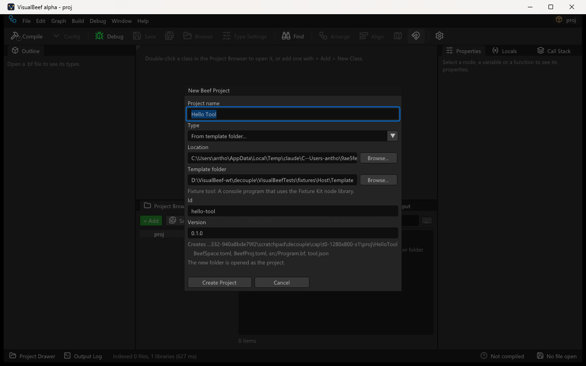
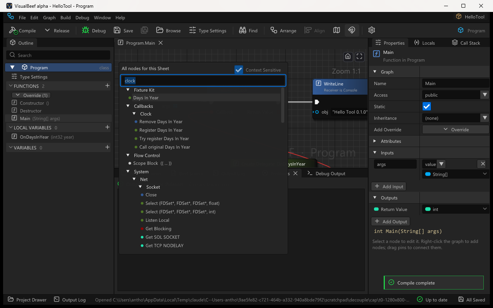

# Host integration

VisualBeef is a standalone editor for Beef. A **host tool** is any program that wants its users to
edit Beef projects in VisualBeef: a launcher, a mod platform, a game tool, a build system. This page
is the whole contract between the two. A host needs nothing from VisualBeef's source code, and
VisualBeef knows nothing about any particular host: everything below is generic, and VisualBeef
never names a host in its code, UI or docs (the `vocabulary` test suite enforces it).

The contract has five parts:

| Part | What the host provides | What VisualBeef does |
|---|---|---|
| [Command line](#command-line) | Starts `VisualBeefEditor.exe` | Opens a project, or creates one from a template |
| [Template manifest](#template-manifest) | A template folder with `template.json` | Copies and fills in the files, writes `.vbproject` |
| [Project manifest](#project-manifest) | Optionally its own `.vbproject` | Focuses the main file, picks the configuration, the attach module, extra libraries |
| [Node libraries](#node-libraries) | Attributes in its Beef library | Shows the tagged functions as nodes, callback-shaped APIs as callback nodes |
| [Installed by a host tool](#installed-by-a-host-tool) | `host-install.json` beside the exe | Leaves updates to the host |

A project made this way is an ordinary Beef workspace: `BeefSpace.toml`, `BeefProj.toml`,
sources. It builds with BeefBuild with or without VisualBeef, and VisualBeef's own side files
(`.vbproject`, `*.vblayout`) never change what the compiler sees. The graphs are a way of editing
the code, not a runtime.



## Version

`VisualBeefEditor.exe --version` prints

```
VisualBeef 0.2.2-alpha (host contract 1)
```

The number after `host contract` is `VisualBeefInfo.HostContract`. It changes when the command
line, `template.json` or `.vbproject` change shape in a way a host has to follow; additions that
older hosts can ignore (a new optional key) do not change it. A host that needs a feature reads the
number first and tells its user to update VisualBeef when it is too low.

## Command line

```
VisualBeefEditor.exe [<folder-or-file>] [--file <bf>] [--view]
VisualBeefEditor.exe --new-from-template <template folder> <destination> [--name <name>] [--var KEY=VALUE]...
                     [--file <bf>] [--no-open]
VisualBeefEditor.exe --version | --help
```

| Argument | Meaning |
|---|---|
| (none) | Reopen the last project and tabs. |
| `<folder-or-file>` | A project folder (holding `BeefSpace.toml`, `BeefProj.toml` or `.vbproject`); one of those files (opens its folder); or a `.bf` file (opens the nearest folder above it that has one of them, and focuses the file). |
| `--file <bf>` | The file to focus: absolute, or relative to the project folder. Default: `main` of the folder's `.vbproject`. |
| `--view` | Read-only: nothing is ever written to the project. |
| `--new-from-template <t> <d>` | Before the window opens: write a new project from the template folder `<t>` into the folder `<d>` (created when missing), then open `<d>` with the template's main file focused. **No file is ever overwritten**: when any file the template would write exists in `<d>`, nothing is written and the exit code is 1. |
| `--name <name>` | The project's name, `@@Name@@` in the template. Default: the name of the destination folder. |
| `--var KEY=VALUE` | A template variable, `@@KEY@@`. Repeatable; the last value of a key wins. Keys are letters, digits, `_` and `.`. |
| `--no-open` | With `--new-from-template`: exit after writing the project (exit code 0) instead of opening it. |
| `--version`, `--help` | Print and exit; nothing is opened. |

`--new-from-template` prints one `Created <path>` line per file to stdout. `--name`, `--var` and
`--no-open` without `--new-from-template` are usage errors.

Exit codes:

| Code | When |
|---|---|
| 0 | The editor ran and was closed, `--version` / `--help` printed, or `--no-open` wrote the project. |
| 1 | The window could not be created, or the project could not be written from the template: `template.json` missing or invalid, a file it lists missing, an unknown `@@KEY@@`, a file that exists already, an I/O error. The reason goes to stderr. |
| 2 | Bad command line: an unknown option, a missing value, two paths, a path that does not exist (the template folder included). The reason and the usage go to stderr. |

The editor is a GUI program: output goes to a redirected stdout / stderr as is, and to the parent
console when started from a terminal. Start it detached, with its own folder as the working
directory, and do not make it inherit the host's handles (on Windows: shell execute, or
`CreateProcess` without handle inheritance), so a host's caller never waits for the editor.

A command-line option of contract 1 that an older host used to fill in a project folder is still
accepted for one release: it prints a deprecation line to stderr and maps onto
`--new-from-template` (or, without a template folder, onto a plain open). New hosts use only the
options above.

Parsing and resolution are `EditorArgs` and `ProjectContract` in
`VisualBeefCore/src/Document/CommandLine.bf`; tested by `VisualBeefTests host`.

## Template manifest

A **template folder** holds `template.json` and the files it lists. The host ships the folder
(next to its own files, in its data folder, wherever it likes) and either passes it to
`--new-from-template` or lets the user pick it in File > New Project > **From template folder...**.

```json
{
  "template": 1,
  "name": "Visual tool",
  "description": "A tool with Initialize, Tick and Shutdown graphs.",
  "host": "Example Host",
  "variables": [
    {"key": "Id", "label": "Id", "default": "@@Slug@@"},
    {"key": "Version", "label": "Version", "default": "0.1.0"}
  ],
  "files": [
    "BeefSpace.toml",
    {"from": "files/BeefProj.toml", "to": "BeefProj.toml"},
    {"from": "files/Main.bf.txt", "to": "src/@@Identifier@@.bf"},
    {"from": "files/icon.png", "to": "icon.png", "raw": true}
  ],
  "main": "src/@@Identifier@@.bf",
  "configuration": "Release",
  "attach": {"module": "HostRuntime.dll", "hint": "Start the game from Example Host, then Refresh."},
  "libraries": [
    {"name": "HostKit", "path": "../../libs/HostKit"}
  ]
}
```

| Key | Required | Meaning |
|---|---|---|
| `template` | no | Format number, `1`. A higher number is refused with "Update VisualBeef". |
| `name` | no | Shown in the New Project dialog and written to `.vbproject`. Default: the folder name. |
| `description` | no | One sentence for the dialog. |
| `host` | no | The host's display name, used in VisualBeef's messages ("named by the project's .vbproject (Example Host)"). |
| `variables` | no | Template variables the user can change: `key`, `label` (the dialog's field label, default the key), `default` (may use the built-ins). |
| `files` | **yes** | What to copy. A string copies a file to the same relative path; an object has `from` (in the template folder), `to` (in the project; default `from`) and `raw` (`true`: copied byte for byte, no substitutions; for pictures and fonts). Both paths must stay inside their folders (no rooted paths, no `..`); `to` may use variables. |
| `main` | no | The file to focus after creation (may use variables). |
| `configuration` | no | `Debug` or `Release`: the compile configuration VisualBeef uses by default for the project (a host whose program loads only Release builds sets `Release`). |
| `attach` | no | `module`: the module (DLL or EXE file name) that marks a process the project can be debugged in; `hint`: one sentence the attach dialog shows when no process has it loaded. |
| `libraries` | no | Libraries the project's files reference: `name` and `path` (absolute, or relative to the template folder). `@@Lib.<name>@@` is the library's absolute folder with `/` separators, ready for `BeefSpace.toml`. A library folder that does not exist makes the template invalid. |

### Variables

`@@KEY@@` is replaced in every file's text and in every `to` path. `@@KEY:str@@` is the value
escaped for a quoted string: `\` and `"` get a backslash, as JSON, TOML basic strings and Beef
strings all want. An unknown key is an error (exit code 1 on the command line, a message in the
dialog), so a typo cannot reach the user's project. `@@` that does not enclose a key (letters,
digits, `_`, `.`) is left as it is.

| Built-in | Value for `--name "Hello Tool!"` into `D:\Work\HelloTool` |
|---|---|
| `@@Name@@` | `Hello Tool!` (the name as given; default the destination folder's name) |
| `@@Identifier@@` | `HelloTool`: the ASCII letters, digits and `_` of the name, `_` in front when it starts with a digit. A Beef identifier and a folder name. |
| `@@Slug@@` | `hello-tool`: lower case, every run of other characters one `-`. |
| `@@Folder@@` | `HelloTool`: the destination folder's name. |
| `@@Lib.<name>@@` | The absolute folder of each library in `libraries`, with `/`. |

Order: the built-ins, then each template variable's `default` (which may use the built-ins), then
the `--var` values (or the dialog's fields), which override both.

Name source files that hold `@@...@@` with another extension in the template folder (`Main.bf.txt`)
so no Beef tool indexes the unfilled text.

### What is written

1. Every file of `files`, filled in, under the destination folder. Folders are created.
2. `.vbproject` (below), unless the template lists its own `.vbproject` in `files`: a host that
   keeps its own keys in the manifest writes it from the template like any other file.

From the dialog the destination is `<Location>\<@@Identifier@@ of the name>`; the dialog refuses
an existing folder. The new folder is opened as the project. Implementation:
`TemplateManifest` and `ProjectKind` in `VisualBeefCore/src/Document/ProjectKind.bf`.

## Project manifest

`.vbproject` is a small JSON file beside `BeefSpace.toml` that says "this project is meant to be
edited in VisualBeef" and how. VisualBeef writes it for a project made from a template; a host may
write its own. Every key is optional, and VisualBeef ignores keys it does not know, so a host can keep
its own ids in the same file.

```json
{
  "vbproject": 1,
  "kind": "template",
  "template": "Visual tool",
  "host": "Example Host",
  "main": "src/HelloTool.bf",
  "configuration": "Release",
  "attach": {"module": "HostRuntime.dll", "hint": "Start the game from Example Host, then Refresh."},
  "libraries": ["D:/Example/libs/HostKit"]
}
```

| Key | VisualBeef uses it for |
|---|---|
| `main` | The file to focus when the folder is opened without `--file`. Project-relative; rooted paths and `..` are ignored. |
| `configuration` | The default compile configuration (`Debug` / `Release`) while the user has not chosen one for the project; the toolbar's configuration menu says where it came from. Order: the user's choice for the project, Editor Preferences, `.vbproject`, the Beef IDE's last configuration (`BeefSpace_User.toml`), Debug. |
| `attach` | Debug > Attach to Process lists the processes that have `attach.module` loaded (default: the project's own output file) and shows `attach.hint` when none has. See [Debugging.md](Debugging.md). |
| `libraries` | Library folders (absolute, or relative to the project folder) loaded as node libraries even when the workspace does not list them. |
| `kind`, `template`, `host` | Information: `kind` is `template` when VisualBeef wrote the file; `host` names the host in messages. |

A host may treat the file's presence as "this is a visual project" (for example to show an
**Open in VisualBeef** button). Reading code: `ProjectManifest` in
`VisualBeefCore/src/Document/ProjectKind.bf`.

## Node libraries

A **node library** is an ordinary Beef library (a `BeefLib` project) whose API should appear in
VisualBeef's Node menu. VisualBeef finds libraries without any host-specific rule:

* the projects the workspace's `BeefSpace.toml` lists and the projects depend on (transitively),
  and BeefLibs (`corlib` always);
* a generated library inside the opened folder (a `BeefLib` whose sources are mostly `*.g.bf`, or
  any library folder with a `.vblibrary` marker file), also when only a workspace dependency path
  reaches it;
* the `libraries` of the project's `.vbproject`.

Libraries are parsed from source once and cached (path-keyed, and content-keyed so a regenerated
library with identical files is a cache hit): about 3 s for a 20 000-function generated library in
a Release build, tens of milliseconds on later opens. A host never pre-builds anything for
VisualBeef. See [Catalog-and-Types.md](Catalog-and-Types.md#indexing).

### Attributes

A library chooses what the editor shows with attributes. VisualBeef reads them from the source
text and matches them **by simple name and field names** (`Node`, `NodeAttribute`,
`Some.Namespace.NodeAttribute` are all `Node`), so a library declares its own attribute types with
these names and fields and does not depend on VisualBeef at all. (A project that is happy to depend
on VisualBeef uses the `VisualBeefMeta` library instead; do not import both sets into one file.)
They are ordinary attributes: nothing is kept at run time. Field-by-field reference:
[Node-Attributes.md](Node-Attributes.md).

| Attribute | On | Effect |
|---|---|---|
| `[NodeLibrary("Display Name", Category=...)]` | a class or struct | Every `public static` function of the type is a node, under `Category` (default: the display name). Non-void functions without `ref`/`out` parameters are pure. |
| `[Node(Category=..., DisplayName=..., Keywords=..., Tooltip=..., Pure=...)]` | a function or property | A node. |
| `[CallbackNode("Label", Category=..., Role=..., Callback=...)]` | a function | A **callback node**: one that registers, removes or stands in for a callback (below). |
| `[Expose(Category=..., ReadOnly=...)]` | a field or property | Get (and Set) nodes. |
| `[Pin(Name=..., Tooltip=..., Default=..., Out=true)]` | a parameter | Pin label, tooltip, default; `Out=true` on a `ref` parameter the function only writes makes it an output pin. |
| `[NodeHidden]` | a member or a type | Never offered. |

A library that uses **any** of these attributes is *attributed*: only tagged members (and the
public static functions of `[NodeLibrary]` types) are offered, so a generator's internal helpers,
function-pointer slots and raw twins never reach the menu without being hidden one by one. A library
with no attributes offers its whole public API. A verbatim parameter name (`@Value`, as generators
often write) is labelled `Value`.

### Callback nodes

Many host APIs take a function to call back later: replace a game function, listen for an event,
run something every frame. `[CallbackNode]` marks the functions of such an API:

```beef
[NodeLibrary("Example Kit")]
public static class Clock
{
	[CallbackNode("Register Days In Year", Role="Register")]
	public static Result<void> RegisterDaysInYear(function int32(int32) Callback) { ... }

	[CallbackNode("Try register Days In Year", Tooltip="Registers the callback; false when one is registered already.")]
	public static bool TryRegisterDaysInYear(function int32(int32) Callback) { ... }

	[CallbackNode("Remove Days In Year", Role="Remove")]
	public static void RemoveDaysInYear() { ... }

	[CallbackNode("Call original Days In Year", Role="Original")]
	public static int32 CallOriginalDaysInYear(int32 year) { ... }
}
```

| Field | Meaning | Default |
|---|---|---|
| `DisplayName` (first argument) | The node's title | The function name in words |
| `Category` | Menu path | `Callbacks\|<Type>` |
| `Keywords`, `Tooltip`, `Advanced` | As for `[Node]`; `callback` is always a keyword | |
| `Role` | `Register` (installs the callback), `Remove`, or `Original` (calls the code the callback replaced; used inside the callback). Adds one sentence to the tooltip. | `Register` when there is a callback parameter |
| `Callback` | The name of the callback parameter | The first parameter whose type is a `function` or `delegate` |

The callback parameter is the node's **callback pin**. Its Node menu offers the static functions of
the edited class with exactly that shape, written `=> OnDaysInYear` (no typing), and its tooltip names
the shape. A `Result<void>` return that nothing reads shows a note on the node, as for any call.
Callback nodes are ordinary calls in the code:

```beef
Clock.TryRegisterDaysInYear(=> OnDaysInYear);
```



`VisualBeefTests/fixtures/Host` holds a complete example: `FixtureKit` (a node library with its own
attribute declarations, a `[NodeLibrary]` class, four callback nodes, a `[NodeHidden]` function and
an attributed struct) and `Template` (a template folder whose project references it).

## Installed by a host tool

A host that installs VisualBeef for its users (into its own tools folder, say) and keeps it up to
date writes `host-install.json` beside `VisualBeefEditor.exe`:

```json
{"host": "Example Host", "updates": "host"}
```

| Key | Meaning |
|---|---|
| `host` | The host's display name, shown in Help > Check for Updates and Preferences: "This copy of VisualBeef was installed by Example Host, which keeps it up to date." Default "a host tool". |
| `updates` | `host` (default): VisualBeef never updates this copy itself. `visualbeef`: the host installed it but VisualBeef's own updater handles updates. |

Without the file, a packaged copy updates itself ([Updating.md](Updating.md)). A host that updates
the copy replaces the whole folder with a newer release zip (the folder layout is the zip's), keeps
`host-install.json`, and checks `VERSION.txt` (its first line is the version) or `--version`.

The files a packaged copy needs at run time are the zip's: `VisualBeefEditor.exe`, `vbhost.dll`,
`assets\fonts\`, `LICENSE`, `NOTICE`, `THIRD_PARTY.md`, `THIRD_PARTY\`, `docs\` (the user pages
only) and `VERSION.txt`. Settings, layout, logs, recovery and caches go to
`%LOCALAPPDATA%\VisualBeef` (or `VB_HOME`), never next to the exe. On Linux the AppImage or the
tarball is the unit. See [Releasing.md](Releasing.md).

## Checklist for a host

1. **Find the exe.** Let the user set its path; fall back to the copy you installed. Report a
   missing exe with the path you tried.
2. **Check the version.** Run `VisualBeefEditor.exe --version`, read `host contract <n>`; require
   the contract you were written against.
3. **Ship templates.** One folder per project kind, each with `template.json`. Reference your
   libraries through `libraries` + `@@Lib.<name>@@`, not hard-coded paths. Set `configuration`
   when your program loads only one configuration, and `attach` when your program loads the
   project's output as a module.
4. **Create projects** with
   `VisualBeefEditor.exe --new-from-template <template> <destination> --name <name> --var KEY=VALUE --no-open`
   (exit code 0 = written; 1 = see stderr), or write the files yourself (then write a `.vbproject`
   with at least `main`). Never overwrite a user's folder; VisualBeef will not either.
5. **Open projects** with `VisualBeefEditor.exe "<project folder>"` (and `--file` when you want a
   different file than `main`), detached.
6. **Tag your library.** Declare `NodeLibraryAttribute`, `NodeAttribute`, `CallbackNodeAttribute`,
   `ExposeAttribute`, `PinAttribute` and `NodeHiddenAttribute` (with the fields of
   [Node-Attributes.md](Node-Attributes.md)) in your own namespace, and tag the API. Generated code:
   emit the attributes from the generator.
7. **Installing VisualBeef for your users?** Write `host-install.json` beside the exe.
8. **Build and publish** with BeefBuild as for any Beef project; VisualBeef is not involved.

## Tests

| What | Where |
|---|---|
| Command line, manifests, templates, node library, `host-install.json` | `VisualBeefTests host` (`VisualBeefTests/src/HostTests.bf`); `-lib <dir>` adds timings on any large generated library |
| `[NodeLibrary]` display name and `[CallbackNode]` in the catalog | `VisualBeefTests catalog` (the `Attributed` fixture's `Timers` class) |
| The whole flow in the editor: New Project from the fixture template, callback nodes in the Node menu, a callback picked for the pin, the configuration from `.vbproject`, compile, reopen | `VB_SELFTEST=host` ([Testing.md](Testing.md)) |
| No host product named anywhere | `VisualBeefTests vocabulary` |
