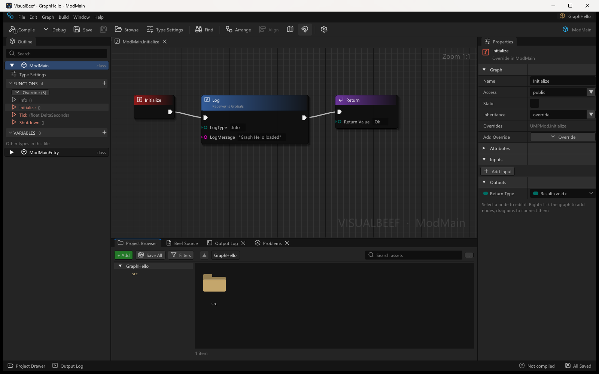
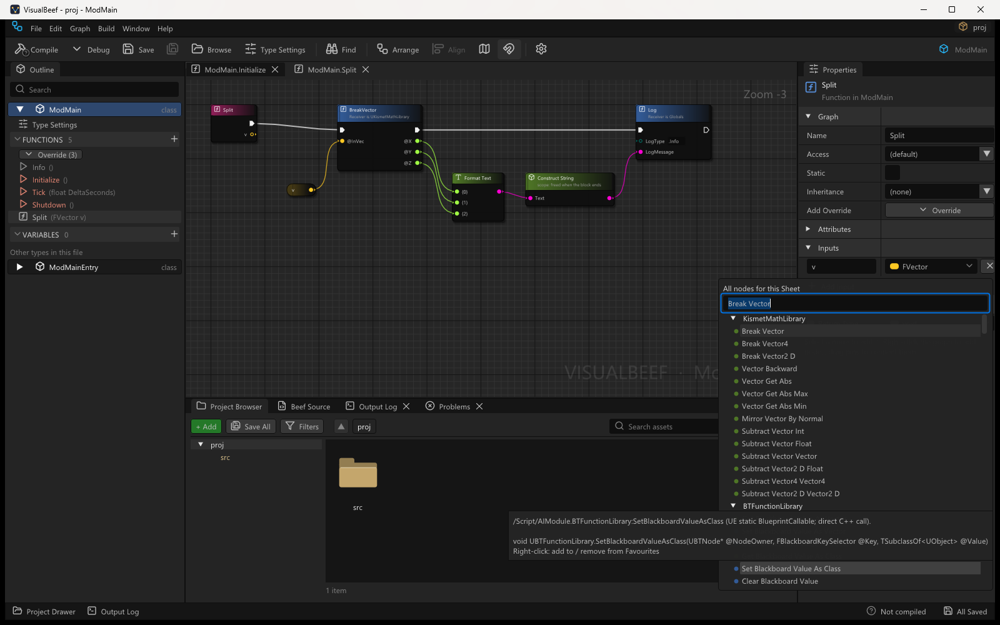
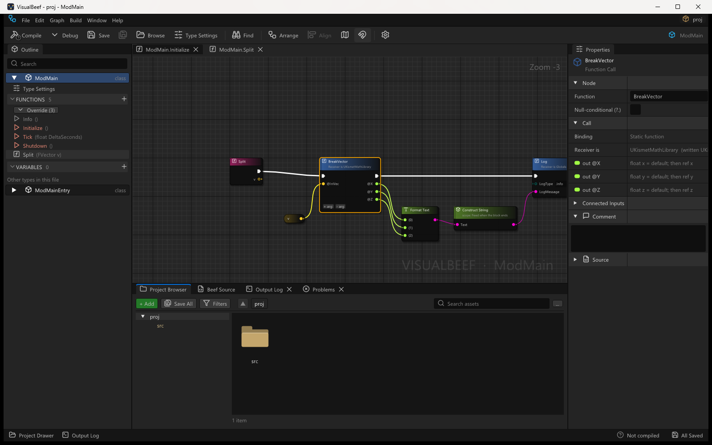

# UMP integration

VisualBeef can open UMP mod projects. A mod is a normal Beef project, so
VisualBeef needs nothing from UMP and UMP needs nothing from VisualBeef; the two meet only through what this
page describes. A launcher can create a mod project, start VisualBeef on it, and build and publish the result
like any other mod. A visual mod is plain
Beef compiled by BeefBuild, so it runs at native speed: the graphs are a way of editing the code, not
a runtime.



## Version

`VisualBeefEditor.exe --version` prints `VisualBeef <version> (UMP contract <n>)`, from
`VisualBeefInfo` (`VisualBeefCore/src/Document/CommandLine.bf`). Today: `VisualBeef 0.1.7-alpha (UMP contract 1)` (the `-alpha` channel suffix is part of the version string; `VERSION.txt` carries the same).
The contract number changes when the command line or the project files below change shape.

## Command line

```
VisualBeefEditor.exe [<folder-or-file>] [--file <bf>] [--view]
                     [--new-ump-mod --mod-id <id> [--namespace <ns>] [--class <name>]
                                    [--mod-name <name>] [--version <v>] [--game <gameId>]]
VisualBeefEditor.exe --version | --help
```

| Argument | Meaning |
|---|---|
| (none) | Reopen the last project and tabs. |
| `<folder-or-file>` | A project folder (holding `BeefSpace.toml` / `BeefProj.toml`); a `.vbproject`, `BeefSpace.toml` or `BeefProj.toml` file (opens its folder); or a `.bf` file (opens the nearest folder above it that has one of those files, and focuses the file). |
| `--file <bf>` | The file to focus: absolute, or relative to the project folder. Default: `main` of the folder's `.vbproject`. |
| `--view` | Read-only: nothing is ever written to the project. |
| `--new-ump-mod` | Before the window opens: write the UMP mod entry class (`TypeTemplates.MakeUMPMod`) into the `--file` (default `src\ModMain.bf`) **if that file does not exist**, and `.vbproject` if it is missing. Existing files are never overwritten. |
| `--mod-id` | Required with `--new-ump-mod`: the mod id written in `Info()`. |
| `--namespace` | Default: the project name from `BeefProj.toml` (`[Project] Name`), else the folder name, as an identifier. |
| `--class` | Default `ModMain`. |
| `--mod-name` | Default: the mod id. |
| `--version <v>` | After `--new-ump-mod`: the mod's version (default `0.1.0`). Anywhere else (or without a value): print VisualBeef's version and exit. |
| `--game <gameId>` | Written into a new `.vbproject`. |
| `--version`, `--help` | Print and exit; nothing is opened. |

Exit codes:

| Code | When |
|---|---|
| 0 | The editor ran and was closed, or `--version` / `--help` printed. |
| 1 | The window could not be created, or `--new-ump-mod` could not write a file. |
| 2 | Bad command line: an unknown option, a missing value, two paths, a path that does not exist, `--new-ump-mod` without `--mod-id` or without a project folder, a `--namespace` / `--class` that is not an identifier. The reason and the usage go to stderr. |

The editor is a GUI program: output goes to a redirected stdout / stderr as is, and to the parent
console when started from a terminal. Parsing and resolution are in `EditorArgs` and
`ProjectContract` (VisualBeefCore), tested by `VisualBeefTests ump`.

## Project contract

A UMP mod project is an ordinary Beef workspace: `BeefSpace.toml`, `BeefProj.toml` (a `BeefLib`
built as a DLL), `ModConfig.json`, `README.md`, `src\...`. A **visual** mod adds two files:

* **`.vbproject`**, a small JSON marker that says "this project is meant to be edited in
  VisualBeef" and which file to show first:

  ```json
  {
    "vbproject": 1,
    "kind": "ump-mod",
    "main": "src/ModMain.bf",
    "gameId": "hogwarts-legacy",
    "modId": "my-mod"
  }
  ```

  VisualBeef reads only `main` (a path inside the project; rooted paths and `..` are ignored).
  UMP reads the file's presence (`visual: true` in its project list).
* **`src\ModMain.bf`**, the mod's entry class in the shape `TypeTemplates.MakeUMPMod` writes:
  `using UnrealUMP.Unreal;` (the SDK's namespace, so SDK nodes are written by their type name), an
  `[AlwaysInclude]` static class that registers the mod, and `class ModMain : UMPMod` with
  `Info()` and the `Initialize`, `Tick` and `Shutdown` overrides as block bodies, so each one opens
  as a graph. The Overrides list offers `OnEngineReady` and `OnWorldReady`.

**Source of truth.** `TypeTemplates.MakeUMPMod` is the one definition of that file. UMP's launcher
writes the same bytes itself (`ModTemplate.AppendVisualModSource` in UMP), so a project can be created
without VisualBeef installed; both sides pin the exact text in a test (`VisualBeefTests ump` and UMP's
`--selftest-template`), and the end-to-end run below compares the two outputs byte for byte. A change
to the template is a change on both sides plus a contract bump.

Node positions go to `src\ModMain.bf.vblayout` next to the file, as for any VisualBeef file. The
mod builds with or without it.

### Created in VisualBeef

A mod can also start in VisualBeef alone: File > New Project > **UMP Mod**, a name (the mod's display name) and the
**Game SDK** folder (`<launcher folder>\sdk\<game>\<Game>SDK`, or a launcher / UMP folder with one SDK below it).
`UmpModProject` (VisualBeefCore) finds UMP's libraries in the folders above the SDK and writes the launcher's visual mod
project: `BeefSpace.toml`, a DLL `BeefProj.toml` (Release copies the DLL and `ModConfig.json` into
`<launcher folder>/mods/<game>/<id>` when the SDK has the launcher's `sdk.json`), `ModConfig.json` (the keys of UMP's
`docs/Mods.md`, `MinRuntimeAbi` from `UMPDebug/src/Version/RuntimeAbi.bf`, `MinLauncher` empty), `.vbproject`,
`src\ModMain.bf` (`TypeTemplates.MakeUMPMod`) and `README.md`; the mod folder is then opened. Tested by
`VisualBeefTests ump` and `VB_SELFTEST=modauthor` ([Testing.md](Testing.md)).

## SDK libraries

UMP generates a Beef SDK per game (`<launcher data>\sdk\<gameId>\<Game>SDK`, a `BeefLib` of
`*.g.bf` files, 20k functions for Hogwarts Legacy). A mod workspace references it by absolute path in
`BeefSpace.toml`. VisualBeef loads it as a cached **library**, never as project files:

* through the workspace dependency (the usual case: the SDK is outside the mod folder);
* a generated library *inside* the opened folder is found by the project scan (`*.g.bf` majority or
  a `.vblibrary` marker); one the scan does not reach (under `build\`, a dot folder) but that a
  workspace dependency points at is loaded as a library too (`LibraryIndex.Discover`);
* absolute dependency paths written with `/` are normalised, so the cache key does not depend on the
  spelling.

Caching is VisualBeef's: the first open parses the SDK (about 3 s in a Release build when the
libraries load in parallel, 18 s single-threaded in Debug), later opens load it from the
path-keyed cache in tens of milliseconds, and a regenerated SDK with identical files hits the
content-keyed cache ([Catalog-and-Types.md](Catalog-and-Types.md#indexing)). UMP never has to
pre-build anything for VisualBeef.

### What the SDK declares

Since UMP's `UnrealSDKEmitter` v5 the generated code carries node metadata that VisualBeef reads
from the source text ([Node-Attributes.md](Node-Attributes.md)):

| Emitted | On | Effect in VisualBeef |
|---|---|---|
| `[Node(Category="<engine class>", Tooltip="...")]` | functions the engine marks as callable from its own visual scripting | a node in the menu under that category |
| `..., Pure=true` | the ones marked pure | no flow pins |
| `DisplayName="..."`, `Keywords="<original name>"` | functions with a `K2_` prefix | the name without the prefix; the original stays searchable |
| `[Pin(Out=true)] ref T @X` | parameters the function only writes | an **output pin** |
| `[Expose(Category="...", ReadOnly=...)]` | properties the engine exposes to its visual scripting | Get (and Set) nodes |

Because the SDK uses these attributes, it is an *attributed* library: only the tagged members are
offered, and the call variants UMP generates for its own use (the `_PE` twins, the `SdkHooks` slots,
the raw `Original_` function-pointer fields) never appear.

### Hooks from the Node menu

The same attributes tag the hook family of every function, in the category `Hooks|<Class>`:

| Node | Writes | Notes |
|---|---|---|
| **Hook Days In Year** / **Unhook Days In Year** | `UKismetMathLibrary.Hook_DaysInYear(=> OnDaysInYear)` | return a `Result<void>`; an unread one shows a note on the node |
| **Try hook Days In Year** | `UKismetMathLibrary.TryHook_DaysInYear(=> OnDaysInYear)` | returns a `bool` (wire it into a Branch) and logs the failure |
| **Call original Days In Year** | `UKismetMathLibrary.CallOriginal_DaysInYear(year)` | the unhooked code, with the function's own parameter and return types |

The **Callback** pin offers the static functions of the edited class that have its exact shape
(`function uint64(uint64)`), written `=> OnDaysInYear`. The callback takes the native shape (`uint64`
for every integer), the typed twin takes an `int32`: put a **Cast** on each side. A mod's own
base class adds `ReadModFile` (a call), `ModDirectoryPath` (a Get; inherited protected properties and
fields of the base are offered as **Get** / **Set** under `Variables | <Base> (inherited)`) and, on an
engine string result, **To Owned String** (copies the text and frees the engine's copy; the temporary
it is called on is written `var`, since the method is `mut`).

Searching also matches a member by its raw name as written: `m_LoopStart`, `Hook_DaysInYear`,
`CallOriginal_DaysInYear` find their rows first (underscore pieces match the label's words, the whole
raw name scores on top).

The attributes are declared by UMP itself (`UnrealUMP.Unreal.NodeMeta` in its `UnrealSDKCore`), not
by `VisualBeefMeta`: VisualBeef matches attributes by their simple name and fields, so a library can
carry node metadata without depending on VisualBeef. Mods that tag their own code use
`VisualBeefMeta` as usual.

Parameters are spelled `@Name` in the SDK; pins are labelled `Name`.





A function the SDK writes with `[Pin(Out=true)] ref float @X` becomes, when its output is read,
`float x = default;` before the statement and `ref x` in the call
([Calls-and-Receivers.md](Calls-and-Receivers.md#out-parameters-output-pins)).

## What UMP calls

| UMP | Runs |
|---|---|
| Create screen, **Visual mod** (or `UnrealUMP.exe --create-mod <game> <name> <dir> --visual`) | nothing of VisualBeef: writes the project, `.vbproject` and `src\ModMain.bf` itself |
| **Open in VisualBeef** (Create result, My projects; `ump_projects_open_visual(modId)`; `UnrealUMP.exe --open-visual <dir>`) | `VisualBeefEditor.exe "<dir>" --file "<dir>\<main>"`, started detached with the exe's folder as working directory |
| Build / Publish | BeefBuild on the project, as for any mod; VisualBeef is not involved |

UMP finds the exe at its Settings value (Developer > VisualBeef path), then the environment
variable `UMP_VISUALBEEF`, then `<launcher folder>\tools\VisualBeef\VisualBeefEditor.exe`, and
reports a missing exe with the path it tried.

## Files VisualBeef needs at run time

Checked by running the Release build from an empty folder (no Beef install on the path, `VB_HOME`
pointed at a scratch folder): the editor opened the project, loaded its fonts and icons, indexed the
SDK and saved.

| File | Notes |
|---|---|
| `VisualBeefEditor.exe` | The Release build links the Beef runtime statically: it imports only Windows DLLs and `vbhost.dll` (no `Beef042RT64.dll`). |
| `vbhost.dll` | Window, rendering and the node canvas; imports only Windows DLLs. |
| `assets\fonts\lucide.ttf`, `assets\fonts\LICENSE-lucide.txt` | Icon font (the UI text font needs no file in the folder). |
| `LICENSE`, `NOTICE`, `THIRD_PARTY.md` | Licences (Apache-2.0; `vbhost.dll` carries third-party notices). |

Settings, layout, logs, recovery and caches go to `%LOCALAPPDATA%\VisualBeef` (or `VB_HOME`), never
next to the exe.

## End-to-end check

On 2026-10-10, with no game running, from a scratch launcher data folder:

1. `UnrealUMP.exe --data-dir <scratch> --create-mod hogwarts-legacy "Graph Hello" <projects> --visual`
   wrote `BeefSpace.toml`, `BeefProj.toml`, `ModConfig.json`, `.vbproject`, `src\ModMain.bf`, `README.md`.
2. With `src\ModMain.bf` and `.vbproject` moved aside, `VisualBeefEditor.exe <project> --new-ump-mod
   --namespace GraphHello --mod-id graph-hello --mod-name "Graph Hello" --version 0.1.0 --game hogwarts-legacy`
   wrote both files again: byte-identical to the launcher's.
3. The editor showed `Initialize`, `Tick` and `Shutdown` under Functions; the Tick graph was opened
   with a posted double-click, the node menu with a posted right-click (the search text pre-filled by
   `VB_DEBUG_NODE_MENU_SEARCH`, see [Testing.md](Testing.md#verifying-the-ui)), **Break Vector** was
   added with a posted click and the file saved with the Save button.
4. In a second run the `Tick` body was given the code VisualBeef writes when Break Vector's X output is read
   (`float x = default; ... UKismetMathLibrary.BreakVector(default, ref x, ref y, ref z);`), so the SDK's
   `[Pin(Out=true)] ref` call shape is compiled; `UnrealUMP.exe --build-mod <project>` built it Release; `--pack-mod` and `--install-zip` installed
   the zip; `--list-mods hogwarts-legacy` listed `graph-hello 0.1.0`.
5. `UnrealUMP.exe --open-visual <project>` started the editor on the project with `--file ...\src\ModMain.bf`.

## Not covered yet

* An unconnected pure node is kept in the `.vblayout` side file only; wiring SDK nodes into flow is
  ordinary graph editing, not specific to UMP.
* A pure call without a return value still shows a value pin (VisualBeef gives every expression call
  one); its outputs are the useful pins.
* Packaging (shipping the files above in UMP's launcher folder) is a separate work item.
